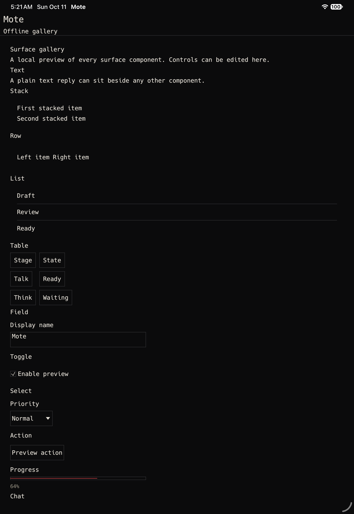

# IPAD-01: Apple Rust build compatibility

Status: verified. The final native shell verification is recorded below.
Date: 2026-10-11, America/Los_Angeles.
Base commit: `4b1f795` on `main`.

## Environment

Commands: `rustc -Vv`, `cargo -V`, `sw_vers`, `xcodebuild -version`,
`xcrun --sdk iphonesimulator --show-sdk-version`, and
`xcrun --sdk iphoneos --show-sdk-version`.

Output:

```text
rustc 1.89.0 (29483883e 2025-08-04)
host: aarch64-apple-darwin
LLVM version: 20.1.7
cargo 1.89.0 (c24e10642 2025-06-23)
macOS 26.6.2 (25G83)
Xcode 27.0 (27A266a)
iOS Simulator SDK 27.0
iPhoneOS SDK 27.0
```

## Pre-change failure

Command: `cargo tree -p mote-client -i glutin`.
Exit: 0.

```text
glutin v0.32.3
├── eframe v0.31.0
│   └── mote-client v0.0.0
└── glutin-winit v0.5.0
    └── eframe v0.31.0
```

Command: `cargo tree -p mote-client -e features -i eframe`.
Exit: 0. The default feature set enabled `accesskit`, `default_fonts`, `glow`, `wayland`,
`web_screen_reader`, and `x11`.

Command: `cargo check -p mote-client --target aarch64-apple-ios-sim`.
The first run exited 101 because the target's `std` and `core` crates were not installed.

Command: `rustup target add aarch64-apple-ios-sim aarch64-apple-ios`.
The restricted attempt could not write the download cache.
The approved unrestricted retry exited 0 and installed both targets.
`rustup target list --installed` then included both target names.

The unchanged simulator check was repeated after installation.
It exited 101 with this renderer failure:

```text
Checking egui_glow v0.31.0
error: Please select at least one api backend
  --> glutin-0.32.3/src/lib.rs:28:1
28 | compile_error!("Please select at least one api backend");
error: could not compile `glutin` (lib) due to 39 previous errors
```

This is the failing build check used before changing the dependency configuration.

## Renderer configuration

The workspace pins eframe and egui to `=0.31.0`.
Eframe now has `default-features = false` and exactly `accesskit`, `default_fonts`, and `wgpu`.
The existing `eframe.workspace = true` entry in `mote-client/Cargo.toml` inherits this configuration.
No source, fixture, golden, layout, hit-region, or event contract was changed.

Commands:

```text
cargo tree -p mote-client -e features -i eframe
cargo tree -p mote-client --target aarch64-apple-ios-sim -i wgpu
cargo tree -p mote-client --target aarch64-apple-ios-sim -i metal
cargo tree -p mote-client --target aarch64-apple-ios-sim -e features -i wgpu-hal
```

All exited 0. Eframe exposes exactly the three selected features.
The Apple dependency path is eframe 0.31.0, egui-wgpu 0.31.0, wgpu 24.0.5,
wgpu-core 24.0.5, wgpu-hal 24.0.4, and metal 0.31.0.
Winit remains 0.30.13. AccessKit remains 0.17.1.
The iOS feature graph enables Metal and does not enable the Glow renderer.

## Simulator compile check

Command: `cargo check -p mote-client --target aarch64-apple-ios-sim`.
Exit: 0.

```text
Checking egui-wgpu v0.31.0
Checking egui-winit v0.31.0
Checking eframe v0.31.0
Checking mote-client v0.0.0
Finished `dev` profile [unoptimized + debuginfo] target(s) in 47.45s
```

The same build command failed at glutin before the dependency change and passed after it.
This verifies compilation only, without an iOS app link or launch.

## Restricted test attempt

Command: `cargo test -p mote-client`.
The restricted run exited 101 with 159 passing tests and five socket permission failures:

```text
app::tests::close_and_reopen_subscribes_from_durable_cursor_and_ignores_stale_replay
app::tests::reconnect_removes_expired_matrix_controls_and_preserves_chat_and_cursor
app::tests::restart_between_status_and_subscription_rechecks_the_watermark
cursor::tests::desktop_reads_the_daemon_public_key_identity_before_migrating
tests::rejected_matrix_submission_still_opens_chat_for_logged_diagnostic
```

Each failed with `Os { code: 1, kind: PermissionDenied, message: "Operation not permitted" }`.
The last test reproduced the same failure when run alone with `-- --nocapture`.
The suite was rerun with approved local socket access.

## Mac regression suite

Command: `cargo test -p mote-client`, with approved local socket access.
Exit: 0.

```text
test result: ok. 164 passed; 0 failed; 0 ignored; 0 measured; 0 filtered out;
finished in 43.40s
```

The unchanged suite covers all fixture rendering, layout at both golden viewports, 48 point hit
regions, AccessKit role goldens, light and dark themes, typed control events and reconnect behavior.
The pre-existing unused test helper warning for `ObservationHarness::legacy` remains.
No expected shape, role, event, or golden output was changed.

## Workspace verification

Commands: `cargo test --workspace` and `cargo clippy --workspace -- -D warnings`.
Both exited 0 with approved local socket access.
The test output contains 580 passing tests, zero failures and two ignored live Bonjour tests across
48 result summaries, including zero-test documentation suites.
Strict clippy completed without warnings in 7.54 seconds.
The workspace test run retains the pre-existing unused test helper warning for
`ObservationHarness::set_viewport` and `ObservationHarness::legacy`.

The implementation commit is the commit containing this evidence and the WGPU manifest change.
The controller's task report records its exact SHA after creation.

## Remaining acceptance after Task 1

Tasks 1 and 2 address renderer compatibility and shared-core extraction.
The native iOS shell, both Rust target builds, Xcode application build,
and Simulator launch remain later tasks.
No physical-device, touch, privacy-prompt, VoiceOver, signing, or TestFlight result is claimed.

## Shared core extraction

Date: 2026-10-11, America/Los_Angeles. Base: `57e812b` on `main`.
Environment remains macOS 26.6.2, Apple Silicon, Rust and Cargo 1.89.0,
Xcode 27.0 (27A266a), iOS Simulator SDK 27.0.

Before extraction, `cargo test -p mote-client --test core_boundary` exited 101 with
`shared Matrix core must be a workspace package`.
`cargo check -p mote-client-core --target aarch64-apple-ios-sim` exited 101 because
the package did not exist.

The new core owns contract decoding, chat reduction, both surface renderers, accessibility,
the existing Vector theme, gallery data and change-discard behavior.
The Mac modules re-export the same implementation. State IDs, structural paths, roles,
colors, hit regions, event payloads and fixture goldens are unchanged.
All 164 original client test names remain. There are 58 tests in the core and 106 in the Mac client.
The two new boundary tests supplement them.

The core depends directly on egui, accesskit, mote-ui, mote-protocol, serde and serde_json.
The JSON codec is a narrow addition to the plan's dependency list. It preserves the existing
JSON contract decoding, reducer inputs and typed event values.
The boundary test checks that allowlist and rejects transitive service and Apple framework
dependencies for the Simulator target. Production code has no filesystem or socket access.
The fixture rendering test reads checked-in files only under `cfg(test)`.

`mote-eventlog::Event` now publicly re-exports `mote_protocol::Event`.
The new event boundary test pins its exact JSON, source compatibility and reducer output.
Restoring the former duplicate DTO made the test build fail with E0308.
Using the protocol DTO makes it pass.

Commands and results:

```text
cargo test -p mote-client-core
58 passed; 0 failed

cargo test -p mote-client
106 passed; 0 failed
2 boundary tests passed; 0 failed

cargo check -p mote-client-core --target aarch64-apple-ios-sim
Finished dev profile; exit 0

cargo check -p mote-client-core --target aarch64-apple-ios-sim --features test-observation
Finished dev profile; exit 0

cargo check -p mote-client --features test-observation
Finished dev profile; exit 0

cargo clippy --workspace -- -D warnings
Finished dev profile; exit 0
```

The Mac test command used approved local socket access. Its first restricted attempt passed
102 tests and hit the same five socket permission failures listed above.
All five passed on the approved run. The pre-existing desktop observation dead-code warnings
remain in test and observation-feature builds. Default strict workspace clippy is clean.

The neutral renderer probes and Matrix harness live in the core observation feature.
The Mac observation harness and its layout and accessibility tests remain in the desktop crate
because they exercise real Mac navigation, workers and IPC framing.
The existing public Mac observation helpers still compile.
Gallery pages and materialization are later tasks. IPAD-01 and IPAD-02 remain unchecked.

`cargo test --workspace` exited 0 with approved local socket access after extraction.
The run passed 582 tests with zero failures and two existing ignored live Bonjour tests
across 51 result summaries. Protocol goldens and eventlog, daemon and gateway regressions passed.

The implementation commit is the commit containing this extraction and evidence.
The controller's task report records its exact SHA after creation.

## Native shell and full acceptance

Date: 2026-10-11, America/Los_Angeles. Base: `f040fa4` on `main`.
The implementation commit is the commit containing this section, the iOS shell and the IPAD-01
README checkmark. Its exact SHA is recorded in the Task 3 report after commit creation.

The environment is macOS 26.6.2 (25G83), Apple Silicon, Rust 1.89.0
(`29483883e 2025-08-04`), Cargo 1.89.0 (`c24e10642 2025-06-23`),
Xcode 27.0 (`27A266a`), iOS Simulator SDK 27.0 (`24A430`) and
iPhoneOS SDK 27.0 (`24A430`). The final runtime is iOS 27.0 (`24A434`).
The destination is iPad Pro 11-inch (M5), UDID `43F2F6ED-5C86-4121-B03F-40FE38891C4E`.

Dependency versions are eframe 0.31.0, egui 0.31.0, winit 0.30.13,
egui-wgpu 0.31.0, wgpu 24.0.5, wgpu-core 24.0.5, wgpu-hal 24.0.4,
metal 0.31.0 and AccessKit 0.17.1. The shell uses raw-window-handle 0.6.2
to pass the existing UIKit view to its scene adapter. No dependency version changed.
`cargo tree -p mote-ios --target aarch64-apple-ios-sim --depth 1` confirms the
eframe, egui, shared core and raw-window-handle direct dependencies.

### Red and green build

Before creating the crate:

```text
cargo build -p mote-ios --target aarch64-apple-ios-sim
error: package ID specification `mote-ios` did not match any packages
exit 101
```

After implementation, all six commands exited 0:

```text
cargo check -p mote-protocol --target aarch64-apple-ios-sim
cargo check -p mote-protocol --target aarch64-apple-ios
cargo check -p mote-client-core --target aarch64-apple-ios-sim
cargo check -p mote-client-core --target aarch64-apple-ios
cargo build -p mote-ios --target aarch64-apple-ios-sim
cargo build -p mote-ios --target aarch64-apple-ios
```

Both full static-library builds were repeated after the final scene and safe-area changes.
The final runs finished in 6.35 seconds for Simulator and 1.57 seconds for the physical target.
`lipo -info` reported `arm64` for both `libmote_ios.a` artifacts.
Physical-target evidence is compilation only.

### Native lifecycle failure and fix

The initial Xcode build succeeded, but iOS 27 stopped the app with SIGTRAP.
The Simulator log named `_UIApplicationEvaluateRuntimeIssueForNoSceneLifecycleAdoption`:

```text
Application failed to launch: UIScene life cycle is required for apps built with this SDK.
```

The checked-in `testOfflineGalleryLaunchRemainsInForeground` reproduced this with a missing
window, a terminated process and no screenshot. It failed with three assertions.
The identical unadapted binary stayed alive for 41 seconds on the iOS 26.5 (`23F77`)
iPad Pro 11-inch destination `E425A8EA-DEE3-4538-97FD-F31E25EC38D4`.
That comparison was diagnostic and did not close the criterion.

[Apple's scene lifecycle migration document](https://developer.apple.com/documentation/uikit/transitioning-to-the-uikit-scene-based-life-cycle)
states the iOS 27 requirement. The pinned winit source creates a UIWindow and calls UIApplicationMain.
It does not attach that window to a UIWindowScene.
The native adapter now declares one scene and attaches the window supplied by eframe's live UIKit
view handle. Winit remains the only owner of UIApplicationMain. There is no SwiftUI or second loop.
The delegate does not render product UI. All gallery rendering and state remain in Rust.

The first successful screenshot exposed a heading underneath the system status bar.
`cargo test -p mote-ios gallery_heading_clears_native_top_safe_area` reproduced the bug:

```text
heading starts under the system status bar at 2
test result: FAILED. 0 passed; 1 failed
```

The native shell now reports its safe-area insets to Rust. The iOS app applies them around its
own panels. The shared Matrix core and desktop geometry are unchanged.
The same focused test then passed. The final screenshot confirms the heading is below the status bar.

### Xcode, installation and live launch

The project uses `local.mote.simulator`, arm64 and deployment target iOS 16.0.
Code signing is disabled. No development team is configured.
The Rust build phase uses Cargo's locked dependency graph and rejects non-Simulator platforms.
The plist includes the local-network purpose text and `_mote._tcp`. It adds no ATS exception.

```text
xcodebuild -project ios/Mote/Mote.xcodeproj -scheme Mote -configuration Debug -destination 'platform=iOS Simulator,id=43F2F6ED-5C86-4121-B03F-40FE38891C4E' -derivedDataPath target/ipad-derived build
** BUILD SUCCEEDED **

xcodebuild -project ios/Mote/Mote.xcodeproj -scheme Mote -configuration Debug -destination 'platform=iOS Simulator,id=43F2F6ED-5C86-4121-B03F-40FE38891C4E' -derivedDataPath target/ipad-derived -resultBundlePath target/ipad-final-startup.xcresult test
Test Case '-[MoteUITests testOfflineGalleryLaunchRemainsInForeground]' passed (11.877 seconds).
Executed 1 test, with 0 failures
** TEST SUCCEEDED **

xcrun simctl install 43F2F6ED-5C86-4121-B03F-40FE38891C4E target/ipad-derived/Build/Products/Debug-iphonesimulator/Mote.app
exit 0

xcrun simctl launch 43F2F6ED-5C86-4121-B03F-40FE38891C4E local.mote.simulator
local.mote.simulator: 60511

ps -p 60511 -o pid,etime,stat,command
PID    ELAPSED STAT COMMAND
60511  00:52   Ss   .../Mote.app/Mote

xcrun simctl spawn 43F2F6ED-5C86-4121-B03F-40FE38891C4E launchctl list
60511  0  UIKitApplication:local.mote.simulator[47e2][rb-legacy]

xcrun simctl io 43F2F6ED-5C86-4121-B03F-40FE38891C4E screenshot /Users/bilal/projects/mote/docs/verification/assets/IPAD-01-simulator-gallery.png
Wrote screenshot to: .../docs/verification/assets/IPAD-01-simulator-gallery.png
```

The final `test` command rebuilt the app and its Rust library before launch.
The startup test asserts foreground state, a visible window, and survival after five seconds.
It retains an app screenshot in `target/ipad-final-startup.xcresult`.
Manual inspection of the committed screenshot verifies the actual gallery pixels: Mote,
Offline gallery, Surface gallery, the text, stack, row, list, table, field, toggle, select,
action and progress sections. The app contains no host transport or model runner.
`otool -L` confirms that the native app links Metal.



Simulator services and Xcode caches needed approved local access. The restricted simctl attempt
failed to connect to CoreSimulatorService. The approved retry succeeded.
The XCUITest runner emits Apple's duplicate WebKit accessibility class warning and a debugger
version diagnostic. Neither affects the passing test. These are not physical accessibility evidence.

### Final regression gate

```text
cargo test --workspace
584 passed; 0 failed; 2 ignored; 53 result summaries; exit 0

cargo clippy --workspace -- -D warnings
Finished dev profile in 1.04s; exit 0

plutil -lint ios/Mote/Info.plist ios/Mote/Mote.xcodeproj/project.pbxproj
Both OK

/bin/sh -n ios/Mote/build-rust.sh
exit 0

git diff --check
exit 0
```

The workspace run includes the existing 107-test Mac client suite, the shared-core renderer suite,
protocol goldens and the new safe-area test. No Rust test failure or clippy warning remains.
The two ignored tests are the existing live Bonjour checks.
Full local logs are retained under `.superpowers/sdd/2026-10-11-ipad-simulator-ui/` as
`task-3-workspace-verified.log`, `task-3-clippy-verified.log`, and `task-3-final-xcuitest.log`.

IPAD-01 is verified. IPAD-02 and later criteria remain open.
No physical touch, privacy prompt, VoiceOver, signing, App Store Connect or TestFlight result is claimed.
