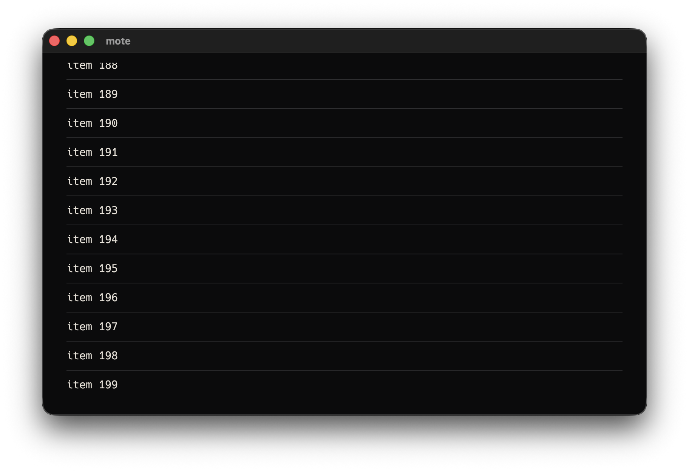
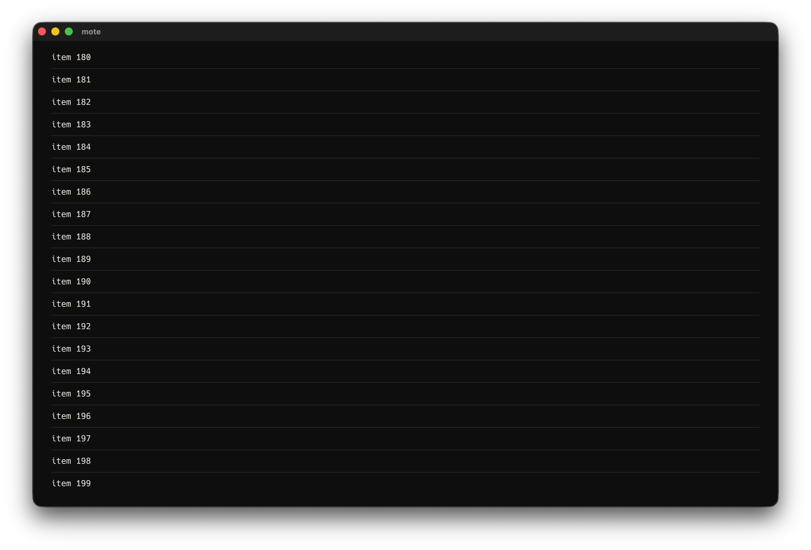
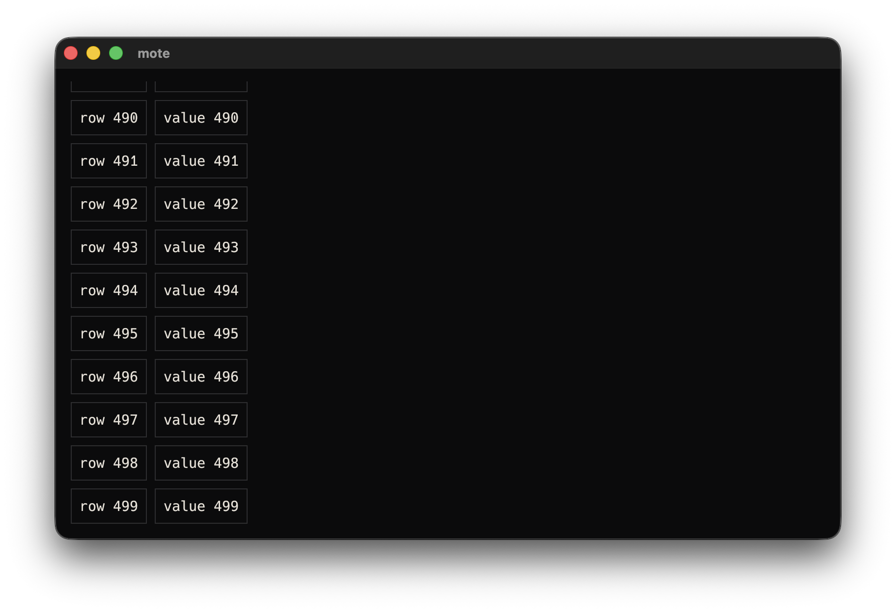
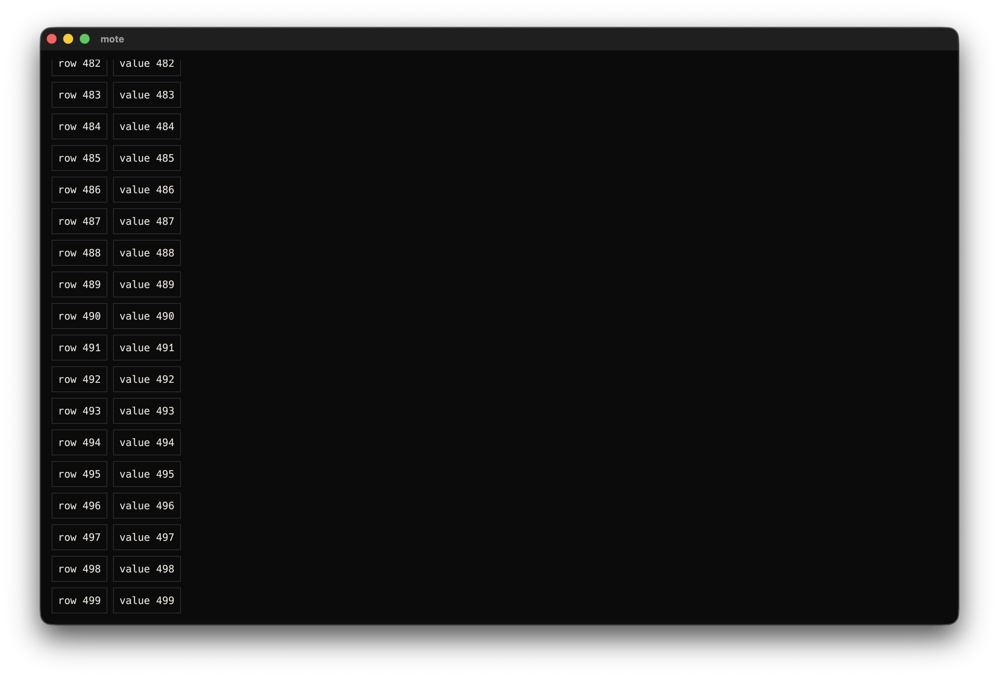

# UI-15: Runtime overflow evidence

Status: partial. Native Mac capture is complete. Repetition on later approved targets remains open.

Date: 2026-10-10. Original base: `a5c286d`. Production-shell correction base: `2a9b490`.
Environment: macOS 26.6.2 (25G83), Rust 1.89.0, Cargo 1.89.0, egui/eframe 0.31.0.
The measurements below are headless logical-point observations of the shared production
application shell. The later native section records separate visible Mac captures.
Both `eframe::App::update` and ObservationHarness invoke `MoteApp::draw_shell`.
The fixture shell uses 16-point margins.
The chat shell includes the actual 68-point top navigation panel and central panel with 16-point margins.
The measurements are not physical touch captures.

```text
cargo test -p mote-client layout_200_list_items_and_500_table_rows_reach_the_final_row -- --nocapture
test result: ok. 1 passed; 0 failed
```

The test renders a 200-item List and a 500-row, two-column Table.
Each runs at exactly 800 by 480 and 1280 by 800 in preview and inline chat.
These are eight stress cases.
A real egui wheel event drives each existing outer scroll area to its maximum vertical offset.
The final item or row is fully inside the viewport.
The test checks scroll clips before and after scrolling and checks stable reading order.
Scrolling produces no outbound surface event.

| View | Window | Scroll viewport | Actual paint clip |
|---|---|---|---|
| Preview | 800 x 480 | (16,16) to (784,464) | (13,13) to (787,467) |
| Chat | 800 x 480 | (16,84) to (784,392) | (0,81) to (800,395) |
| Preview | 1280 x 800 | (16,16) to (1264,784) | (13,13) to (1267,787) |
| Chat | 1280 x 800 | (16,84) to (1264,712) | (0,81) to (1280,715) |

The clip includes egui's paint margin around the viewport.
Content bounds are larger than both.
Preview content heights are 7,610 points for the List and 22,036 for the Table.
Chat content heights are 7,668 and 22,094 points, including message chrome.

| View | Window | List final offset | Table final offset | List final text y | Table final text y |
|---|---|---:|---:|---|---|
| Preview | 800 x 480 | 7,162 | 21,588 | 432 to 448 | 438 to 454 |
| Chat | 800 x 480 | 7,360 | 21,786 | 346 to 362 | 352 to 368 |
| Preview | 1280 x 800 | 6,842 | 21,268 | 752 to 768 | 758 to 774 |
| Chat | 1280 x 800 | 7,040 | 21,466 | 666 to 682 | 672 to 688 |

The final labels are `item 199` and `row 499`.
Unclipped content geometry may extend beyond the viewport.
Every observed surface paint command carries a clip contained by the intended scroll clip.
Its visible intersection stays inside the screen.
No new collection scroll area, source modifier or layout engine was needed.

## Native Mac final-row captures

System Events set the native outer window bounds to 800 by 512 and 1280 by 832 logical points.
The 32-point native title bar leaves content regions of 800 by 480 and 1280 by 800. CGWindowList
confirmed the outer bounds before each run. Each temporary fixture was driven through the real
native window with CGEvent pixel scroll-wheel input until its final entry was visible. The captures
show `item 199` for the 200-item List and `row 499` for the 500-row Table.

The List at an 800 by 480 content window:



The List at a 1280 by 800 content window:



The Table at an 800 by 480 content window:



The Table at a 1280 by 800 content window:



The `screencapture` output includes the macOS title bar, border and shadow. The PNG pixel dimensions
therefore differ from the logical content bounds and include Retina scaling.

| Asset | PNG dimensions | SHA-256 |
| --- | --- | --- |
| `UI-15-native-list-800-final.png` | 1824 by 1248 | `600b20d4075d807ef839664f52c6c6f5b85153a8bae9976eb8c0f59d672fa795` |
| `UI-15-native-list-1280-final.png` | 2784 by 1888 | `ee570dfe6786264a53bfb6eabf75ce5d5b52c3abd03c7f162244049b41b932f9` |
| `UI-15-native-table-800-final.png` | 1824 by 1248 | `8297d817e3aebbbf542ec4cd727e0850365eeb2beb69a54545cdfdb2d95f073d` |
| `UI-15-native-table-1280-final.png` | 2784 by 1888 | `c5ae4b3995d3e6d4f1c98ecf7c900e9af32fa30538c440b55c5c816049050d98` |

These visible captures complement the exact clip, viewport and final-offset observations above.
They do not replace those measurements.

The original standalone-harness RED run also exposed the chat composer below the screen.
At 800 by 480 its text response occupied y=503.8 to 520.2.
The chat scroll now reserves 72 points for the composer and separation.
Both composer controls remain fully on screen in the two tested viewports.

The initial evidence used an 8-point standalone central panel and omitted the navigation panel.
Those earlier viewport numbers did not describe a real application window and are superseded here.
The new shell regression failed against that harness at both exact window sizes before the refactor.
It now verifies the actual central and top-panel paint bounds, margins and navigation Tab order.
The central chat panel is (0,68) to the window's bottom-right corner.
The Composer and Send hit regions both span y=414 to 462 at 800 by 480.
They span y=734 to 782 at 1280 by 800.
The Composer hit width is 280 points and Send is 48 points wide.

The composed four-control Stack overflows the smaller chat viewport.
Its Action initially has a clipped 35-point visible hit height.
Scrolling the existing outer area exposes the complete 48-point target while all four controls remain reachable.
No further production layout change was needed.

The native Mac-first clause is complete. No Pi, iPad or later approved target is represented by
this evidence, so UI-15 remains partial.
