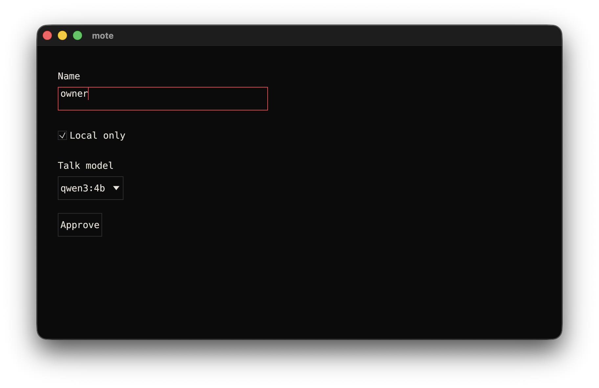
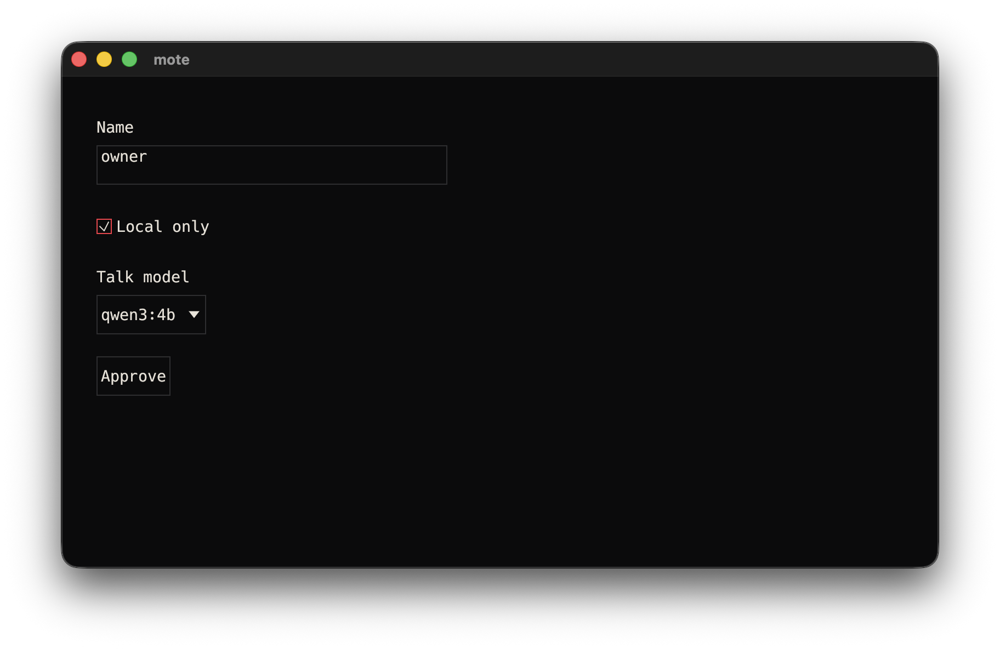
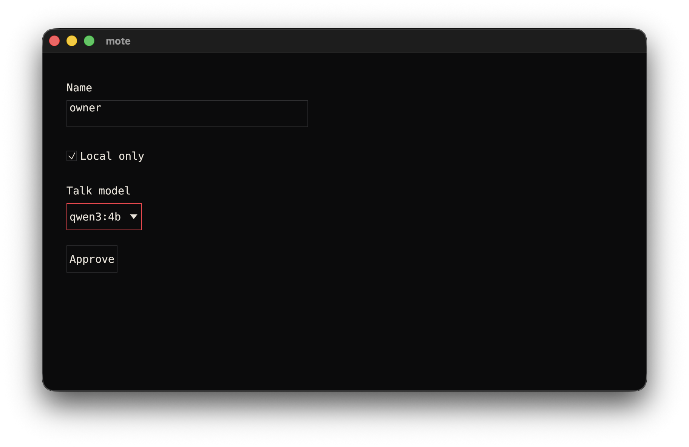
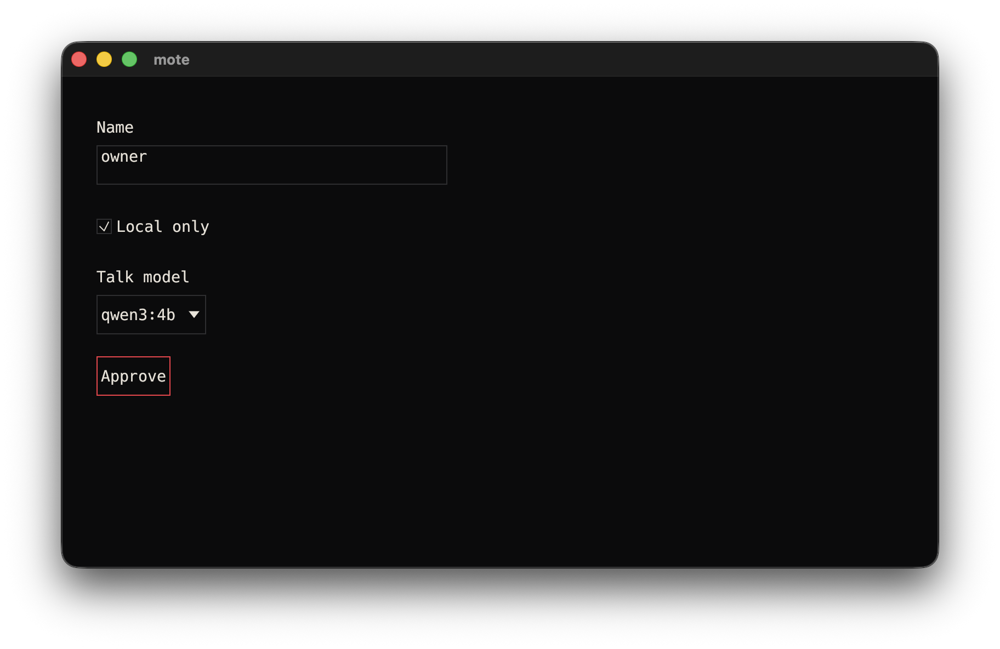
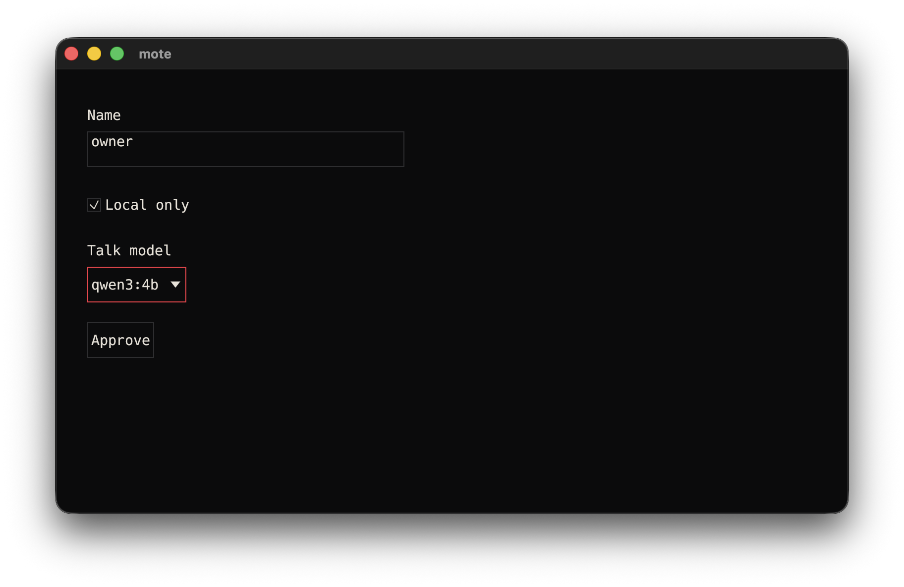
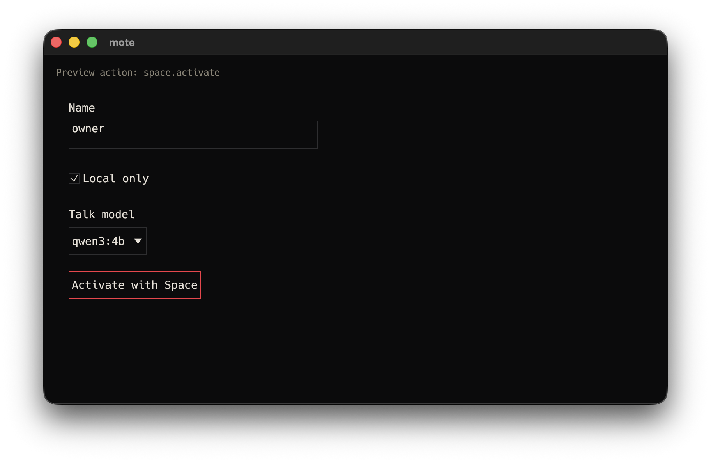
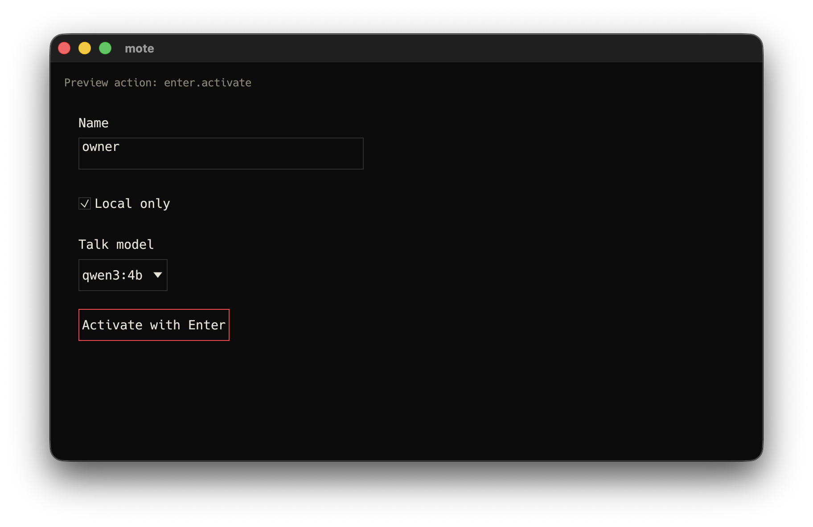

# UI-16: headless v0 keyboard order and activation

Date: 2026-10-10.
Environment: macOS 26.6.2 (25G83), arm64, Rust 1.89.0, Cargo 1.89.0, egui 0.31.0.
Base: `b07c1ec`.
Status: partial. Native Mac fixture acceptance is complete. Broader form, dialog and collection
clauses remain gated on an approved consumer contract.

The test loads all ten unchanged JSON fixtures.
Four fixtures contain interactive controls: Field, Toggle, Select and Action.
For each, Tab focuses its control, the next Tab reaches the chat composer, and Shift-Tab
returns to the same control identity.
The test records real egui focus events and focused widget IDs.
It also places the four fixture controls together and asserts this reading order:

```text
Tab:       Field -> Toggle -> Select trigger -> Action -> chat composer
Shift-Tab: Action -> Select trigger -> Toggle -> Field
```

Opening Select by either Space or Enter exposes both fixture options.
Tab crosses the popup container before the first option.
The options receive focus in their source order, `qwen3:4b` then `qwen3:0.6b`.
Shift-Tab returns from the second option to the first.
Space and Enter on the second option each emit one typed change and close the popup.

Space and Enter each activate Action once.
They each toggle Toggle once.
Field text editing and Enter emit no surface event under the existing v0 behavior.
Traversal and opening a Select emit no surface event.
All assertions inspect the real outbound queue and exact event arguments and context.

```text
cargo test -p mote-client fixture_controls_ -- --nocapture
test fixture_controls_follow_tab_and_shift_tab_reading_order ... ok
test fixture_controls_keyboard_activation_emits_only_permitted_events ... ok
test result: ok. 2 passed; 0 failed

cargo test -p moted runtime_keyboard_edits -- --nocapture
Field edits and traversal emit no events; five keyboard activations dispatch exact UI contracts; zero model requests, packs or ledger rows
test result: ok. 1 passed; 0 failed
```

The daemon integration uses a local scripted model server and isolated data directory.
It dispatches the real queue through daemon admission for two Toggle activations,
two Refresh activations and one Select activation.
It verifies host configuration and surface updates, retained event history and zero model activity.
The initial sandboxed attempt could not bind the scripted server socket.
The recorded passing run had local socket access.

Keyboard Select activation originally left the popup open.
The failing assertion observed both option labels after selection.
The renderer now closes its popup for keyboard activation as it does for pointer selection.

These automated observations are headless. The native section below verifies focus pixels and
keyboard activation separately. Neither section is a platform accessibility dump.
Valid form submission, dialog Escape dismissal and collection arrow navigation remain gated
on the broader consumer contract.

## Fix Round 1: stable widget IDs and parity

Date: 2026-10-10. Base: `ac291e4`.
The environment is unchanged.

Toggle and Action now use explicit IDs for their actual interactive responses.
Moving a surviving surface upward after an earlier Matrix message disappears preserves focus.
Space still activates the same contract.
Removal and retyping do not transfer focus to another control.

The parity test compares the replacement controls with the prior egui Checkbox and Button.
It compares exact headless shapes in both Vector appearances.
It also compares emitted widget roles, names, selected values and focus events.
Cases include idle, hover, keyboard focus, padded-edge pointer activation, Space and Enter.
The existing 48-point target and padded-edge tests remain in the client suite.

```text
cargo test -p mote-client fixture_controls_ -- --nocapture
2 passed; 0 failed

cargo test -p mote-client explicit_control_ids -- --nocapture
1 passed; 0 failed
```

This is shape and widget-event parity evidence.
It is not a native screenshot or platform accessibility role dump.

## Native Mac focus and activation

The release client was driven with native CGEvent Tab and Shift-Tab input. The focus captures show
the Vector red focus treatment moving in reading order from Field to Toggle to Select to Action.
The reverse capture shows Shift-Tab returning from Action to Select.











The original focus sequence used an approximately 840 by 524 logical-point outer window. The
Shift-Tab capture used an 800 by 480 outer window. These screenshots include macOS window chrome,
shadow and Retina scaling, so their PNG dimensions are larger than the window bounds.

Separate release-client fixtures were activated with native CGEvent Space and Enter input. The
Space and Enter fixtures each used an 800 by 480 System Events outer window size. The resulting
status text is visible in the same native window.



The Space result says `Preview action: space.activate`.



The Enter result says `Preview action: enter.activate`.

| Asset | PNG dimensions | SHA-256 |
| --- | --- | --- |
| `UI-16-native-focus-field.png` | 1824 by 1184 | `0a723d4231f33ec39ca8acfcf79fc79b1b48ce98dc2c44f82bee61070941e8e9` |
| `UI-16-native-focus-toggle.png` | 1824 by 1184 | `db8bd98e1aee5bb20b14ba5d9ff4dc855d73426f4b2c1cd4fce33225d3569124` |
| `UI-16-native-focus-select.png` | 1824 by 1184 | `cdd643d03764c50efab95b14ccfabadf128d14e87c9bfa72e898562924798ff7` |
| `UI-16-native-focus-action.png` | 1824 by 1184 | `13c96ee89ec8b4198b7afe97cf2dbc557a1fbce21b7adf1746fc1e6bb5e09bf1` |
| `UI-16-native-shift-tab-select.png` | 1824 by 1184 | `0dd1982679d1e51a4d5eafecb2485b03ea4b04016c37f3f60318ed7408800cfe` |
| `UI-16-native-space-activation.png` | 1824 by 1184 | `914f075e81273a4ae9831610b269929df1da4312914dcee271f3852bc948f7e1` |
| `UI-16-native-enter-activation.png` | 1824 by 1184 | `9c59d32194760f55c3020cbba67abd2f26f12923f921bc106754e83f26bed9ca` |

This completes the native Mac portion of UI-16. Valid form submission, dialog Escape dismissal and
collection arrow navigation remain gated. UI-16 therefore remains partial.
