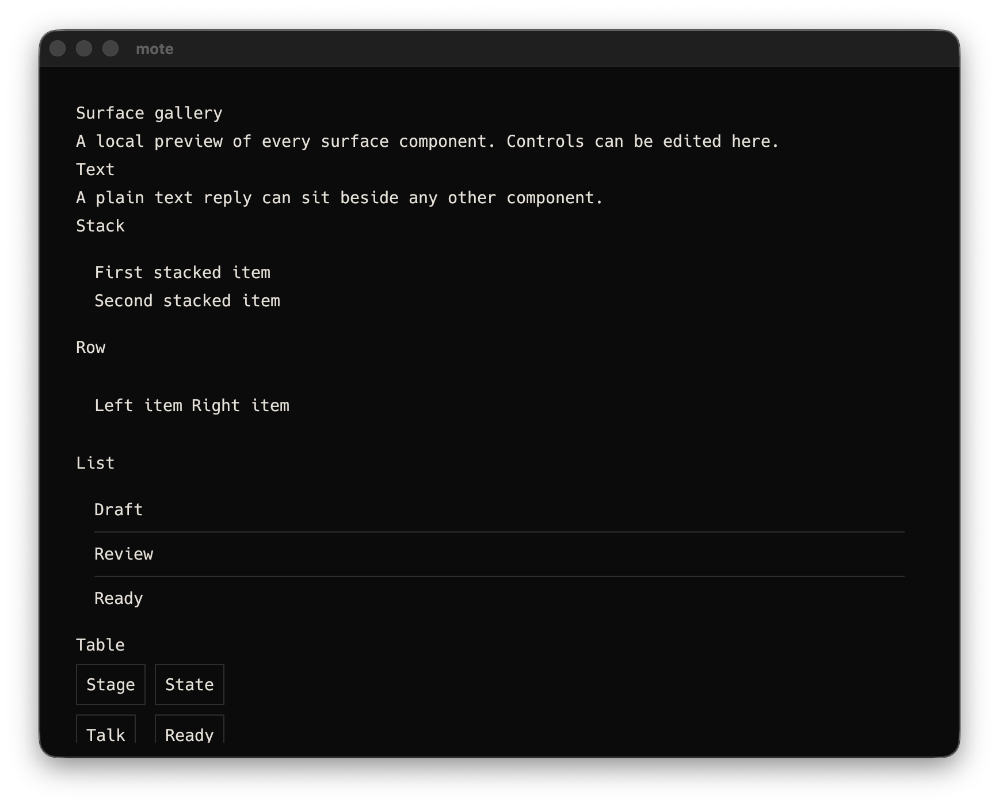
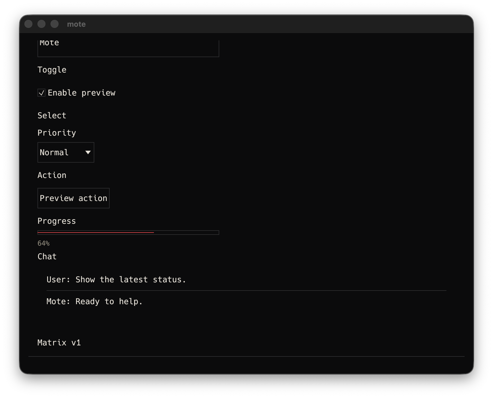
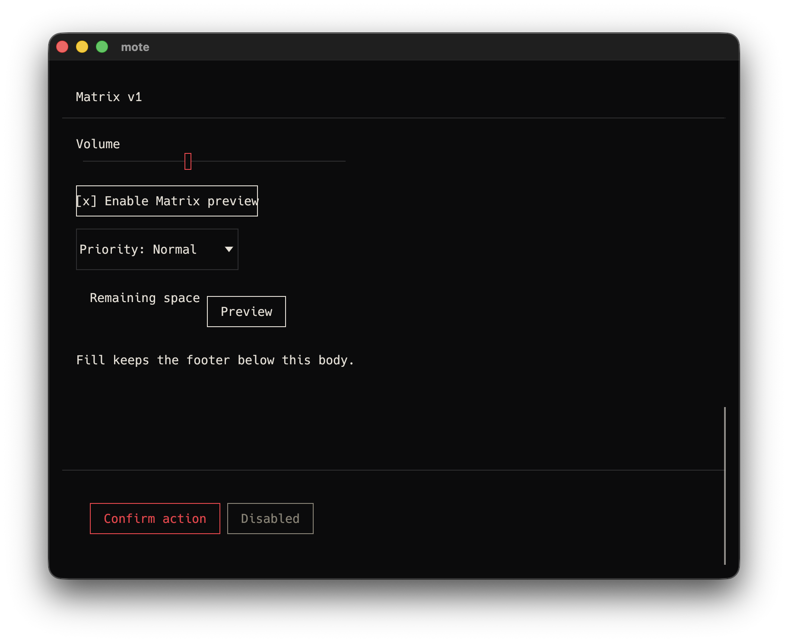

# UI-39 native Rust v0 consumer

Date: 2026-10-10.

Environment: macOS 26.6.2 (25G83), arm64, Rust 1.89.0, Cargo 1.89.0.
Commands ran in `/Users/bilal/projects/mote`.

Status: verified.

UI-39 requires the first Mac consumer to render all eleven unchanged v0 Node variants through the
Rust immediate-mode runtime. It also requires all ten JSON fixture previews, native screenshot
inspection and dependency confirmation for eframe, egui, winit and the absence of icrate.

## Client and fixture verification

Command: `cargo test -p mote-client` with local Unix socket access.

```text
test fixture::tests::gallery_sections_cover_every_surface_variant ... ok
test surface::tests::all_existing_fixtures_draw_without_a_gpu ... ok
test app::observation::layout_tests::layout_all_ten_fixtures_at_both_golden_viewports ... ok
test result: ok. 156 passed; 0 failed; 0 ignored
```

The fixture directory contains exactly ten JSON files:

```text
01_text.json
02_stack.json
03_row.json
04_list.json
05_table.json
06_field.json
07_toggle.json
08_select.json
09_action.json
10_chat_progress.json
```

Fresh recursive inventory with
`jq -r '.. | objects | .type? // empty' crates/mote-ui/fixtures/*.json | sort -u` returned exactly:

```text
action
chat
field
list
progress
row
select
stack
table
text
toggle
```

The fixture draw test validates and renders every file through the production v0 renderer without a
GPU. The layout test constructs each of the ten fixtures through the production observation harness
and renders every one at both golden viewports in both fixture-preview and live shells. It checks
finite stable geometry, clipping, reading order and control bounds. The Gallery inventory test
independently walks the production Gallery tree and requires the same eleven labeled variants.
The test target emitted one dead-code warning for the test-only `ObservationHarness::legacy`
constructor. It had no test failures.

## Delivered dependency path

Commands:

```text
cargo tree -p mote-client -i eframe
cargo tree -p mote-client -i egui
cargo tree -p mote-client -i winit
cargo tree -p mote-client --prefix none | rg -i '^icrate v'
```

Relevant output:

```text
eframe v0.31.0
└── mote-client v0.0.0

egui v0.31.0
├── eframe v0.31.0
└── mote-client v0.0.0

winit v0.30.13
├── accesskit_winit v0.23.1
│   └── egui-winit v0.31.0
│       └── eframe v0.31.0
├── eframe v0.31.0
├── egui-winit v0.31.0
└── glutin-winit v0.5.0

icrate: absent
```

This confirms the delivered native path required by the criterion. It does not infer the dependency
versions from source declarations alone.

## Native screenshot inspection

The first native Gallery capture shows the v0 Text, Stack, Row, List and Table sections.



The second native Gallery capture shows Field, Toggle, Select, Action, Progress and Chat.



Together the two screenshots visibly cover all eleven v0 variants. Both are 1736 by 1400 RGBA PNGs.
Their SHA-256 values are:

```text
837f125d50bd18694510fc13f82cfb27dd3c205f25b94ccf96eec6c7a8d9c9f1  UI-39-native-gallery-v0.png
4e47b88eb2d0f8db90b2ea32840369d2b6dd6725851793ed1eb4c76768292049  UI-39-native-gallery-v0-controls.png
```

The combined Gallery continues below the v0 catalog into the separately versioned Matrix v1 slice.
This additional native capture shows its slider, toggle, select, fill, action and disabled-control
demonstration. It is not used to claim a full versioned catalog.



The v1 capture is an 1824 by 1488 RGBA PNG with SHA-256
`674f917bcfb6a5cbd2810545f71e98010d2c431cc7f88130d0f5fa41a67937cb`.

These are actual native window pixels. Shape tests and process survival are supporting evidence only
and are not substituted for visible acceptance.

## Completion boundary

UI-39 is verified for the first Mac consumer and the unchanged v0 Node contract. This does not
claim a native accessibility dump, a complete Matrix v1 catalog, Pi or iPad rendering, cross-target
golden parity or hardware-only checks. The Matrix host and runtime umbrella remains open.
