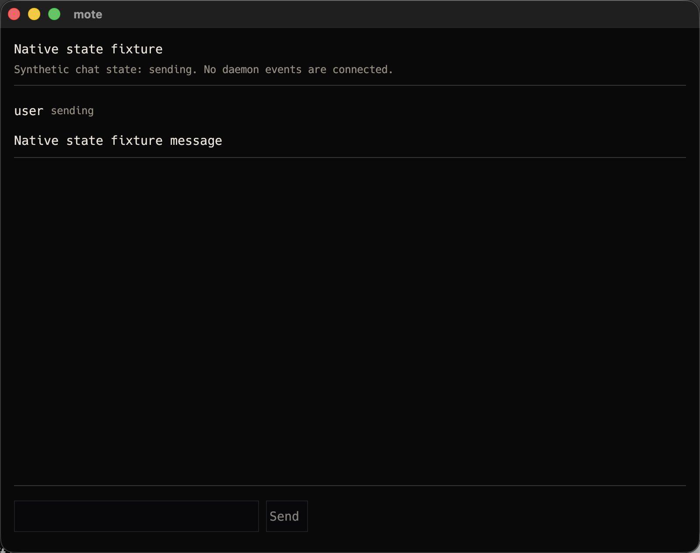
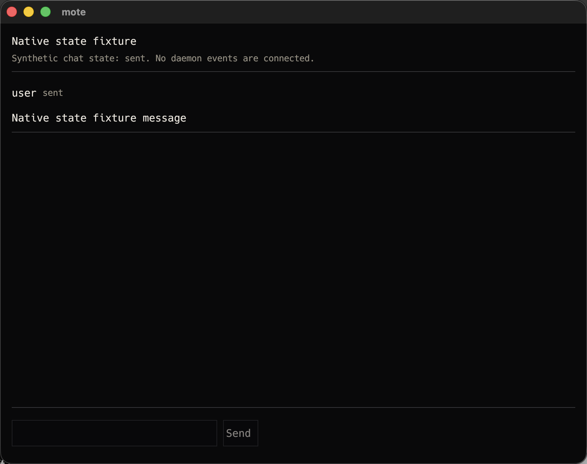
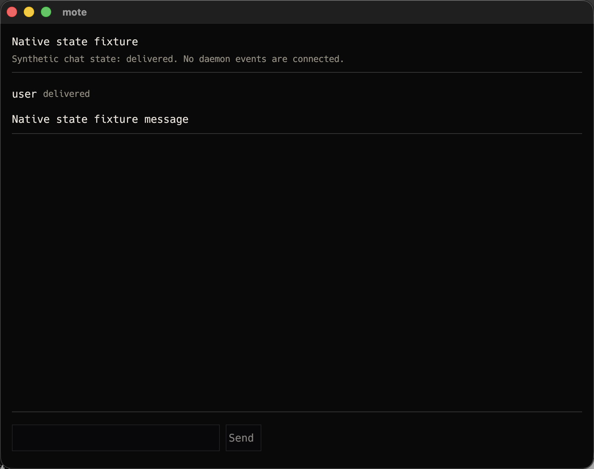
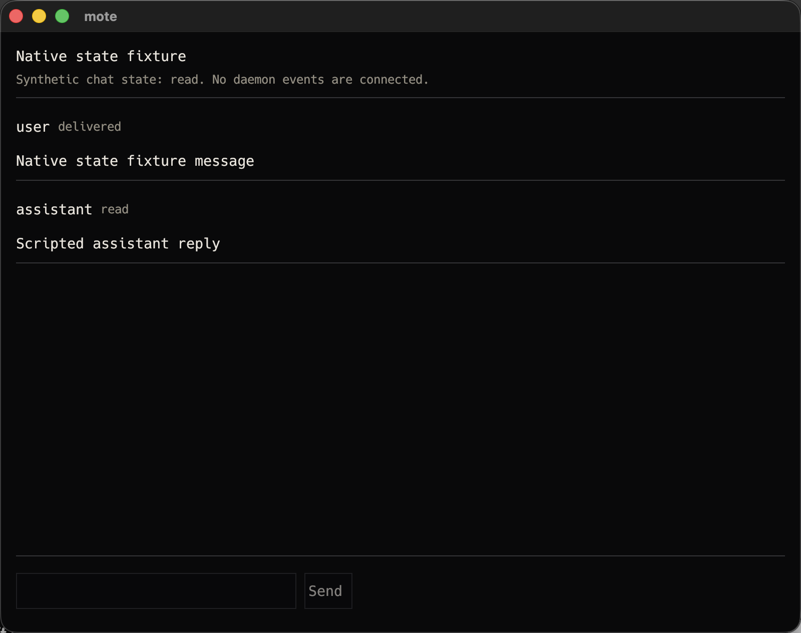
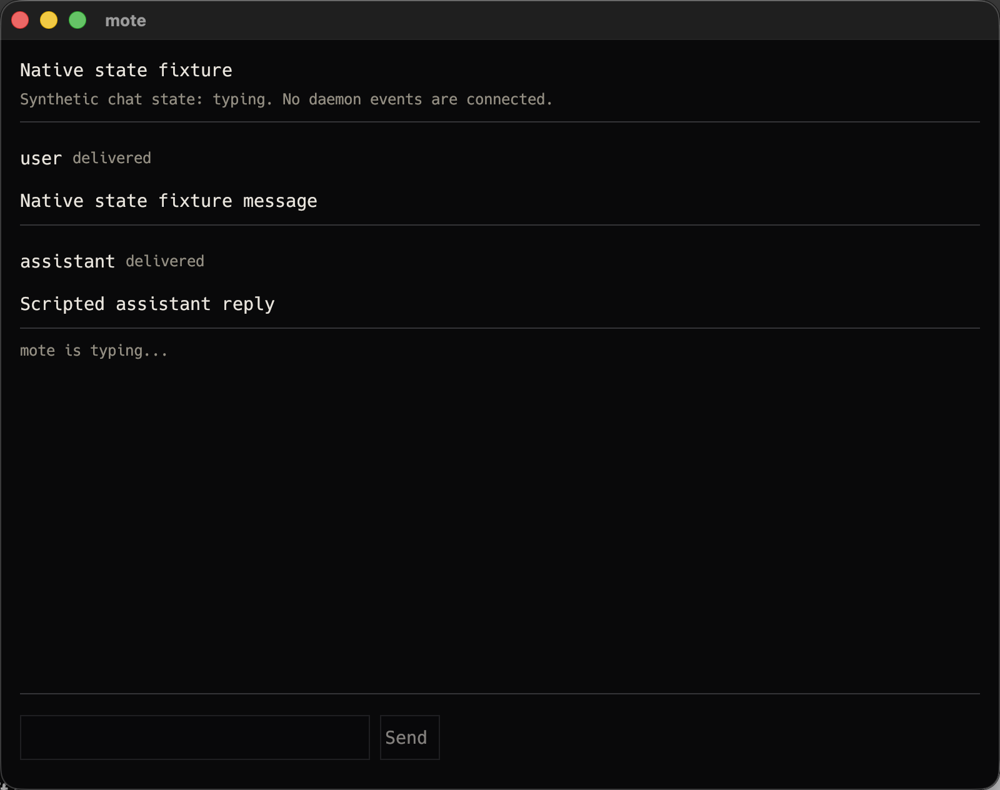

# V0-44 verification

Item: Every message shows one of sending, sent, delivered and read. A typing indicator appears
while `talk.delta` events arrive.

Section: docs/rfcs/v0.md#13-mote-client

## Status: VERIFIED

The native client has an opt-in state fixture for each otherwise transient acceptance state. The
fixture is explicitly labelled synthetic and disconnected. It uses the production `ChatState`
transition methods, reduces real `turn.user`, `talk.delta` and `talk.done` event shapes, and renders
through the production chat view. Normal client startup, cursor handling and daemon streaming are
unchanged.

## Environment

- Date: 2026-10-10
- Host: owner's Mac, Darwin 25.6.0 (arm64)
- Toolchain: cargo 1.89.0
- Commit at capture: uncommitted implementation after `ecf4bc0`
- Native window: 800 by 632 logical points

## Native captures

Each command opens the real native client shell without a daemon or model call:

```text
cargo run -p mote-client -- --chat-state sending
cargo run -p mote-client -- --chat-state sent
cargo run -p mote-client -- --chat-state delivered
cargo run -p mote-client -- --chat-state read
cargo run -p mote-client -- --chat-state typing
```











Every PNG is 1600 by 1264 pixels. SHA-256 values are:

```text
e2f9df22bdb25da3224dba62a41ff58c7f6af27ef5f75b50ce56487d18000352  V0-44-native-sending.png
e4709eb88156eabb45eeb7b1e8fd95c14507c0205f6d581b6867977370d94ecf  V0-44-native-sent.png
195727ac7b3b26e3a4a499767ab52e97566e8926adcb163145f53456b39a9870  V0-44-native-delivered.png
68aa61af016e48a4aefb0b15f8633d8b06726eefb5c87787fa3db1d12b4c53bb  V0-44-native-read.png
4d667c16f9c2d897db4faf186fec0113d7963cc87e82e5fb946accf1e662ec18  V0-44-native-typing.png
```

## Focused verification

```text
$ cargo test -p mote-client chat_state_fixture -- --nocapture
running 4 tests
test fixture::tests::chat_state_fixture_accepts_each_v0_message_state ... ok
test fixture::tests::chat_state_fixture_rejects_unknown_or_extra_arguments ... ok
test tests::chat_state_fixture_is_not_matrix_submission ... ok
test state::tests::chat_state_fixtures_seed_the_requested_reducer_state ... ok

test result: ok. 4 passed; 0 failed
```

The sending, sent and delivered captures label the user message directly. The read capture labels
the assistant message read after the same reducer processed `talk.done`. The typing capture keeps
the assistant message delivered and shows `mote is typing...` after `talk.delta`.
