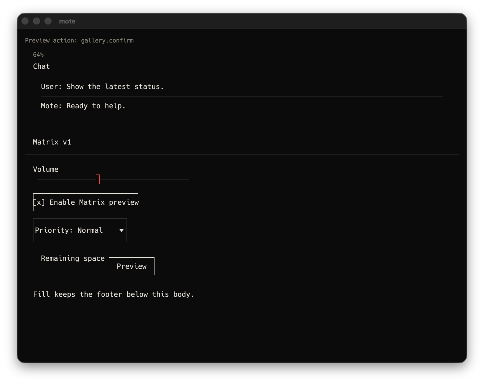
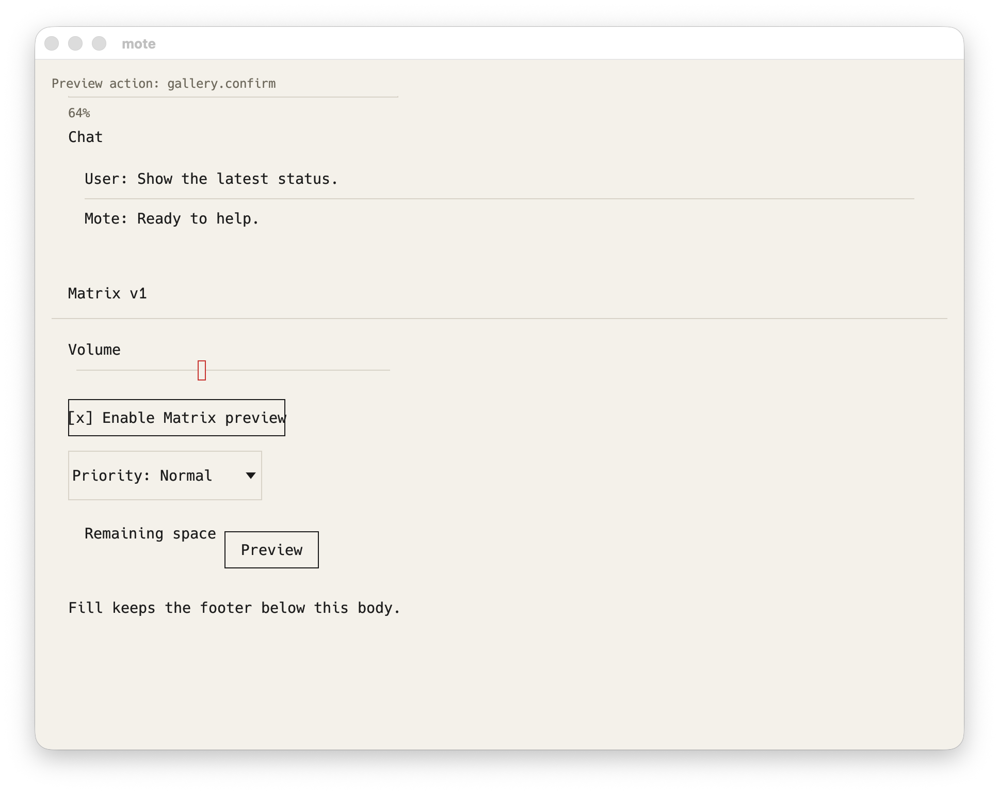

# V0-46 system appearance evidence

Date: 2026-10-10.

Environment: macOS 26.6.2 (25G83), arm64, release `mote-client` using egui and eframe 0.31.0.

Status: verified.

The same native release Gallery window followed a live macOS system appearance change from the
original dark setting to light. System Events restored dark after the capture and confirmed the
system dark flag was true.





Both screenshots are 1936 by 1536 pixels.

```text
d6cd7aeb6b672205a803a9447372d3121b4cd9050d5817b1a52654dddb9af0ad  UI-20-native-dark.png
9e7a1ce51b0a03b877cdf92ee1110cd3216054f5cd701903b85f45294c7f5a1e  UI-20-native-light.png
```

The complete Matrix theme token, focus and no-model evidence is in [UI-20](UI-20.md).
These two native screenshots satisfy the full V0-46 Verify clause.
