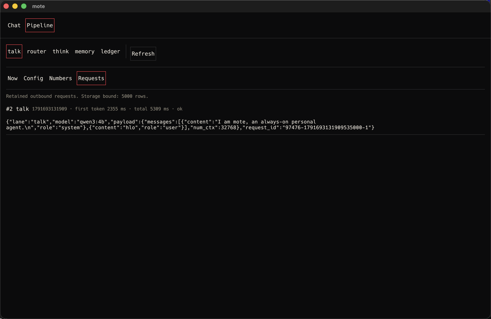
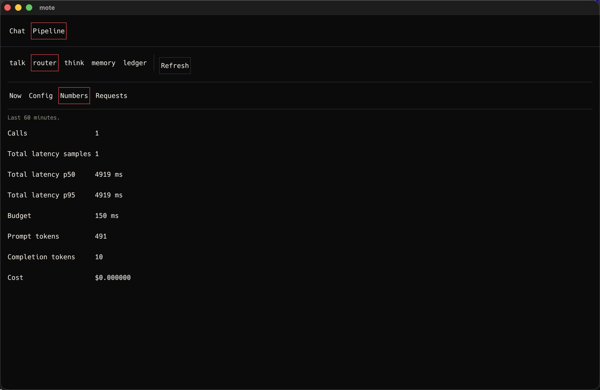
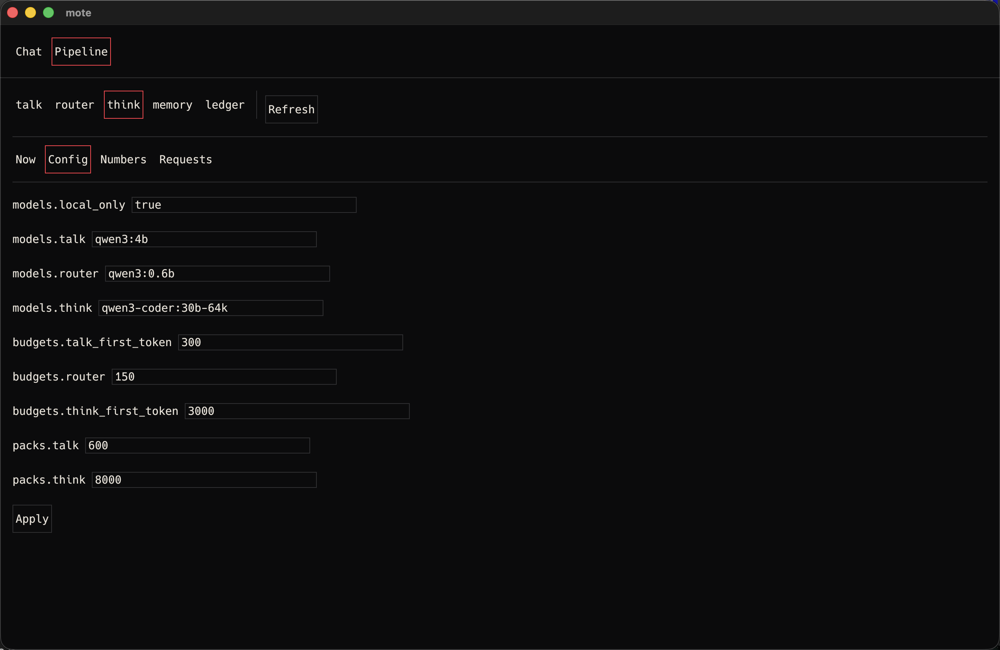
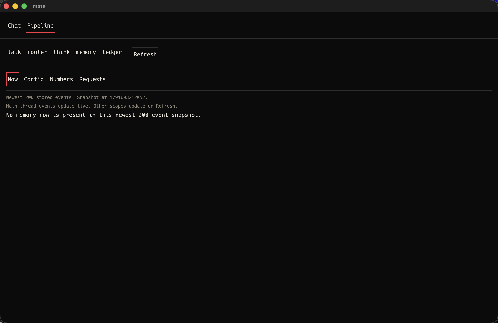
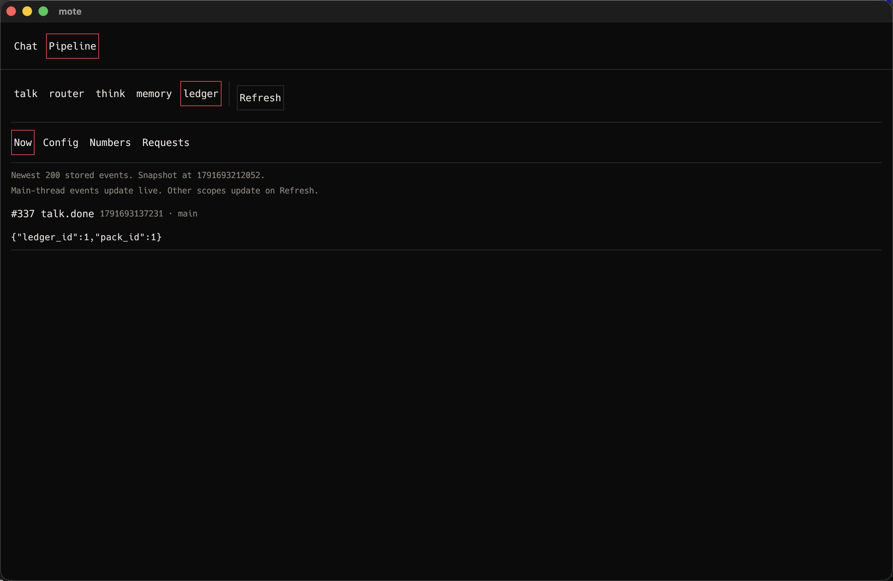

# V0-47 verification

Item: The pipeline screen lists the five stages and each opens Now, Config, Numbers and Requests
tabs.

Section: docs/rfcs/v0.md#14-pipeline-view

## Environment

- Date: 2026-10-10
- Host: owner's Mac, Darwin 25.6.0 (arm64)
- Toolchain: cargo 1.89.0
- Commit at capture: `ecf4bc0`

## Headless production-shell evidence

The client installs one populated pipeline snapshot with distinct stored events, metrics and
requests for talk, router, think, memory and ledger. The test renders at 1280 by 800 through
`MoteApp::draw_shell`. It clicks the real Pipeline navigation item. It then clicks every stage and
every Now, Config, Numbers and Requests tab.

All 20 combinations retain the five stage labels and four tab labels. Now shows the selected
stage's distinct event. Config shows all nine v0 keys. Numbers shows the selected stage's distinct
metrics. Requests shows the selected stage's distinct retained request.

```text
$ cargo test -p mote-client populated_pipeline_shell_exposes_every_stage_and_tab_combination -- --nocapture
running 1 test
test app::observation::tests::populated_pipeline_shell_exposes_every_stage_and_tab_combination ... ok

test result: ok. 1 passed; 0 failed
```

## Native live-turn evidence

Release `moted` and `mote-client` ran with `MOTE_LIVE=1`, `HF_HUB_OFFLINE=1` and isolated data
root `/private/tmp/mote-v047.vzOimW`. No model was pulled. The installed approved models included
`qwen3:4b`, `qwen3:0.6b` and `qwen3-coder:30b-64k`. The generated configuration kept
`models.local_only = true` and named exactly those three models.

The native client sent the greeting `hlo`. The daemon recorded the user event, one talk request,
one router request, a valid `talk` router verdict, both successful model responses and
`talk.done`. The completed call rows were:

```text
1|talk|qwen3:4b|ok|2355|first_token
2|router|qwen3:0.6b|ok|4919|total
```

After one Pipeline refresh, five captures from the same window select every stage and distribute
the four tabs across the stages. The Talk request includes the retained request, model and timing.
Router Numbers includes the live call count and latency. Think Config shows all nine v0 keys.
Memory Now reports the truthful empty result for this turn. Ledger Now links to `talk.done` and
ledger row 1.











Every PNG is 2560 by 1664 pixels. SHA-256 values are:

```text
590ace2b34a2a57036fe5a77331bc0352b2c43e78a5df2f9b4ac170849988d15  V0-47-native-talk-requests.png
5a6b3ba7beceaf07b8d8ffd091e5f5761a94a6637c9c09498985b5d36c132eab  V0-47-native-router-numbers.png
fb0a6142b124f0d48e804455c8c99d642cf619973908796bb41a1d55e356d300  V0-47-native-think-config.png
cd57894a5c6eea9c188411605bab9046e209f8834e75b68ff6f15ddeeb1d4fba  V0-47-native-memory-now.png
a433742d3727f9e27e9b0b96aa186a06ff21324770e6a02297d28f970eb97dc5  V0-47-native-ledger-now.png
```

The client cursor ended at 337. The client closed normally with exit code 0. The owned daemon PID
97476 received TERM and exited. The focused 20-combination production-shell test passed again
after capture.

## Status: VERIFIED

The native live-turn captures prove every stage can be selected and every tab can be opened. The
headless production-shell test covers the complete 20-combination cross-product.
