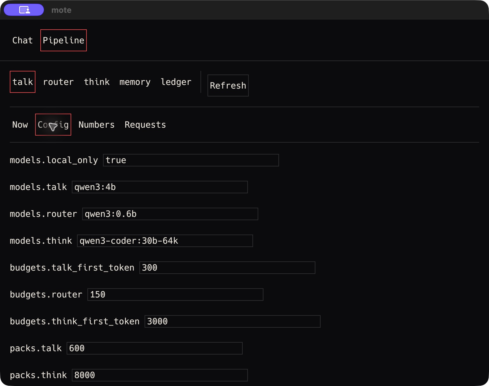
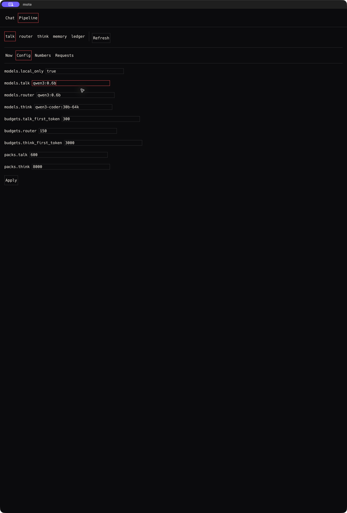
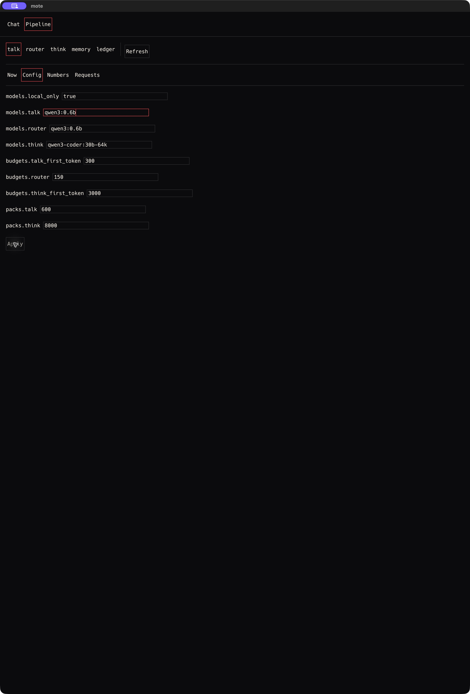

# V0-48 verification

Item: Changing `models.talk` from the Config tab calls `config.set` and the next turn uses the new
model.

Section: docs/rfcs/v0.md#14-pipeline-view

## Environment

- Date: 2026-10-10, America/Los_Angeles. Native interaction ran from 22:03 to 22:05 PDT.
- Host: owner's Mac, Darwin 25.6.0, arm64, 128 GB RAM.
- Toolchain: cargo 1.89.0, Ollama 0.35.0.
- Source revision: `8593b5e0c09f334a5cb45009acca457ac1b3b0b7`.
- Data root: `/private/tmp/mote-v048.ug3RNv`.
- Runtime: `MOTE_LIVE=1`, `HF_HUB_OFFLINE=1`, local Ollama at `127.0.0.1:11434`.
- `models.local_only` remained `true`. No model was pulled. No subscription harness was started.

## Build and launch

```text
$ cargo build --release -p moted -p mote-client
   Compiling mote-client v0.0.0 (/Users/bilal/projects/mote/mote-client)
    Finished `release` profile [optimized] target(s) in 2.04s

$ mktemp -d /private/tmp/mote-v048.XXXXXX
/private/tmp/mote-v048.ug3RNv

$ MOTE_LIVE=1 HF_HUB_OFFLINE=1 MOTE_HOME=/private/tmp/mote-v048.ug3RNv target/release/moted
moted: listening on /private/tmp/mote-v048.ug3RNv/moted.sock
```

Local Ollama access and daemon launch ran outside the command sandbox because the sandbox blocks
localhost and Unix socket access. `ollama list` confirmed the installed approved `qwen3:4b`,
`qwen3:0.6b`, `qwen3-coder:30b` and the configured `qwen3-coder:30b-64k` derivative.

The native control interface could not resolve the bare executable. A temporary app wrapper at
`/private/tmp/mote-v048.ug3RNv/MoteAcceptance.app` launched the same release binary. Its executable
was:

```sh
#!/bin/sh
export MOTE_LIVE=1
export HF_HUB_OFFLINE=1
export MOTE_HOME=/private/tmp/mote-v048.ug3RNv
exec /Users/bilal/projects/mote/target/release/mote-client
```

The wrapper declared `CFBundleIdentifier=com.mote.acceptance.v048`,
`CFBundleExecutable=MoteAcceptance` and `CFBundlePackageType=APPL`. It contains no replacement UI.
The native control session opened it with:

```javascript
var mote = await cua.getApp('/private/tmp/mote-v048.ug3RNv/MoteAcceptance.app');
```

## Native interaction and config.set

The native Chat composer sent `Hello` with Send. Its completed talk call used the default
`qwen3:4b`. The operator opened Pipeline, selected talk, and opened Config. The native tree showed
all nine v0 keys, including `models.local_only=true` and `models.talk=qwen3:4b`.

The operator clicked the visible `models.talk` field, selected its text, and typed `qwen3:0.6b`.
The fresh native tree showed `text field (settable) qwen3:0.6b`. The window was expanded with its
native zoom action to expose Apply. Apply was clicked through the native button.

The effective interaction calls were:

```javascript
await mote.click([280,1178]);
await mote.typeText('Hello');
await mote.click(13); // Send in the current native tree.
await mote.click(3); // Pipeline in the current native tree.
await mote.click([170,410]); // Visible Config tab.
await mote.click([415,610]); // Visible models.talk field.
await mote.pressKey('super+a');
await mote.typeText('qwen3:0.6b');
await mote.performSecondaryAction(2,'zoom the window');
await mote.click(38); // Apply in the current native tree.
```

Native state was refreshed between navigation steps. Coordinates refer to the native screenshots
at the time of each action. Accessibility indices refer to those fresh trees.

The production worker in `mote-client/src/app.rs`, `spawn_config_worker`, sends
`Client::call("config.set", {"key": request.key, "value": request.value})` for this Apply batch.
The daemon's `config.set` handler in `moted/src/main.rs` calls `ConfigStore::set_json` and returns
the changed-event sequence. There was no direct backend config request in this native run.
The native Apply produced exactly one stored config change:

```text
$ sqlite3 /private/tmp/mote-v048.ug3RNv/mote.db \
  'SELECT seq,ts,scope_id,kind,payload FROM events WHERE kind="config.changed" ORDER BY seq;'
459|1791695110962|config|config.changed|{"key":"models.talk","new":"qwen3:0.6b","old":"qwen3:4b"}
```

`config.toml` then contained `local_only = true` and `talk = "qwen3:0.6b"`.







The before image is 1600 by 1264 pixels. The edited and applied images are 2560 by 3780 pixels.
SHA-256 values are:

```text
1703942ef107a815d9f8c7699489a29e818af608d570005fc6d9da28f34f9a63  V0-48-native-config-before.png
d575d95d6fb32628e46a6f180161f51c8475beaf721e49a037cb2424416a346f  V0-48-native-config-edited.png
abeef7d61865f5c27382c629ab50fc23c31df02f12a0c77dca81eec44b9b896e  V0-48-native-config-applied.png
```

## Next native turn and ledger

After Apply, the operator returned to Chat, focused the composer with Tab, typed `Thanks` and
clicked Send. The native tree showed the delivered user text and a completed assistant reply.
This was the next turn after the config change.

```javascript
await mote.click(8); // Chat in the current native tree.
await mote.pressKey('Tab');
await mote.pressKey('Tab');
await mote.pressKey('Tab');
await mote.typeText('Thanks');
await mote.click(19); // Send in the current native tree.
```

```text
$ sqlite3 /private/tmp/mote-v048.ug3RNv/mote.db \
  'SELECT id,lane,model,prompt_tokens,completion_tokens,latency_ms,latency_kind,status FROM ledger ORDER BY id;'
1|talk|qwen3:4b|11|436|1086|first_token|ok
2|router|qwen3:0.6b|490|10|2222|total|ok
3|talk|qwen3:0.6b|454|17|237|first_token|ok
4|router|qwen3:0.6b|490|12|127|total|ok

$ sqlite3 /private/tmp/mote-v048.ug3RNv/mote.db \
  'SELECT seq,ts,scope_id,kind,payload FROM events WHERE kind IN ("turn.user","talk.done","config.changed") ORDER BY seq;'
3|1791695061298|main|turn.user|{"client_message_id":"65182-1791695015001315000-0-0","text":"Hello"}
458|1791695066603|main|talk.done|{"ledger_id":1,"pack_id":1}
459|1791695110962|config|config.changed|{"key":"models.talk","new":"qwen3:0.6b","old":"qwen3:4b"}
460|1791695131025|main|turn.user|{"client_message_id":"65182-1791695015001315000-0-1","text":"Thanks"}
485|1791695131329|main|talk.done|{"ledger_id":3,"pack_id":3}

$ sqlite3 /private/tmp/mote-v048.ug3RNv/mote.db \
  'SELECT seq,ts,kind,json_extract(payload,"$.lane"),json_extract(payload,"$.model"),json_extract(payload,"$.payload.num_ctx") FROM events WHERE kind="model.request" ORDER BY seq;'
4|1791695061382|model.request|talk|qwen3:4b|32768
5|1791695061382|model.request|router|qwen3:0.6b|32768
461|1791695131026|model.request|talk|qwen3:0.6b|32768
462|1791695131026|model.request|router|qwen3:0.6b|32768
```

The sequence proves the native baseline completed, Apply changed the model, and the immediately
following native turn completed with the selected model. Both talk calls used explicit
`num_ctx=32768` and wrote successful ledger rows.

## Client verification and cleanup

```text
$ cargo test -p mote-client
running 160 tests
test result: ok. 160 passed; 0 failed; 0 ignored; 0 measured; 0 filtered out; finished in 48.19s
```

This passing run used local socket access outside the sandbox. An earlier sandboxed invocation
failed four socket-dependent tests with `PermissionDenied: Operation not permitted`.
The same tests passed in the complete rerun. An existing unused `ObservationHarness::legacy`
warning appeared. No production behavior was changed for this task.

The native client was closed with its Quit shortcut. The owned daemon PID 43754 received TERM.
A subsequent `ps -p 43754,65182 -o pid=,command=` returned no processes. The retained isolated
client cursor is `485`. The isolated database and wrapper remain available for inspection.

## Status: VERIFIED

The native Config change called `config.set`. The next native live turn used `qwen3:0.6b`.
The before-and-after talk ledger rows and native screenshots cover the full Verify clause.

The initial 800 by 632 point window clipped Apply below the Config form. Expanding the native
window exposed the button. This layout limitation does not invalidate the completed native run.
