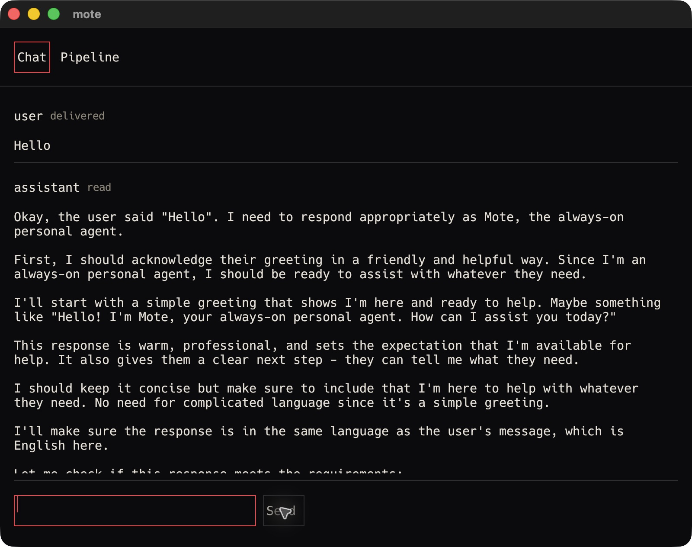
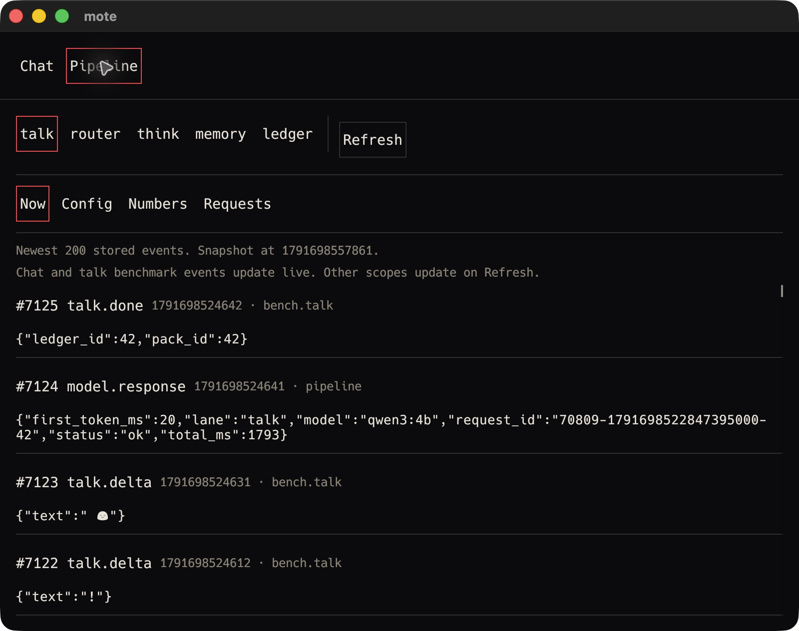
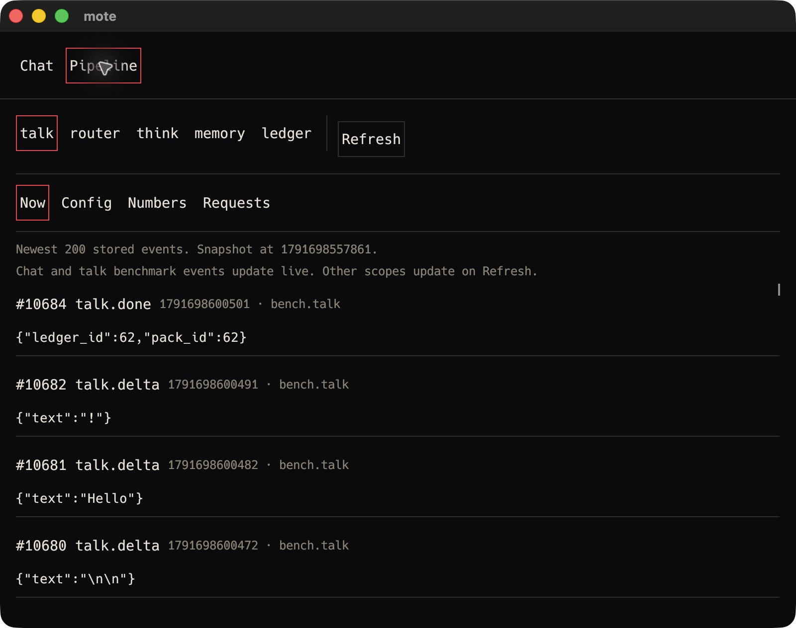
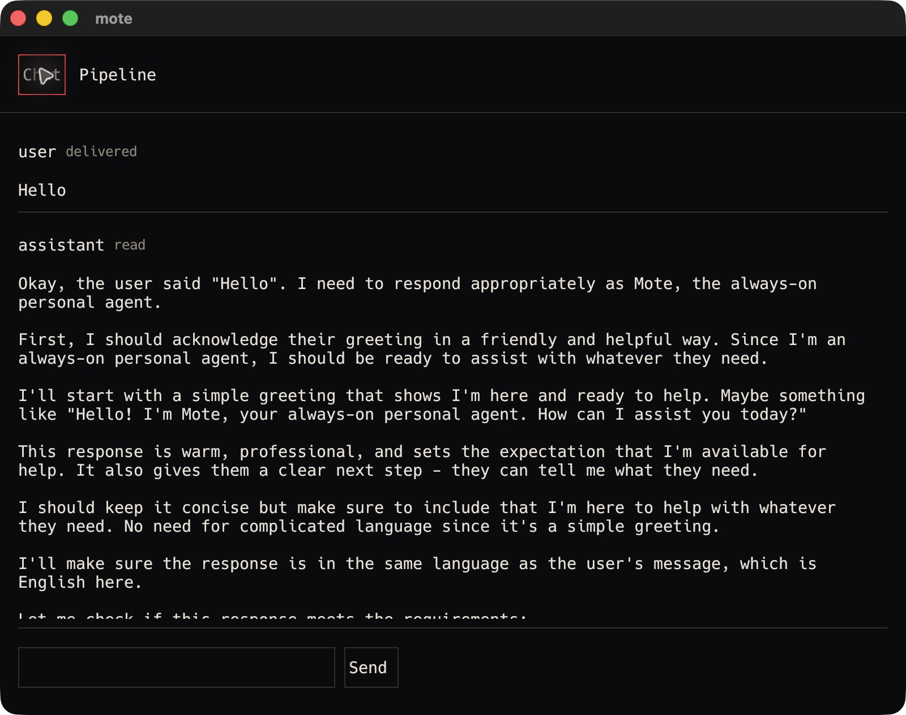

# V0-50 verification

Item: Opening the Pipeline view adds under 5 ms at p50 to the talk lane.

Section: docs/rfcs/v0.md#14-pipeline-view

## Result

The final isolated benchmark measured 17.0 ms with Pipeline closed.
It measured 19.0 ms with Pipeline open.
The p50 increase was 2.0 ms over 20 samples per condition.
The threshold is strictly less than 5 ms.
Pipeline received live events from the isolated benchmark scope.
The existing completed conversation was unchanged.
The README criterion is verified.

## Environment and build

- Date: 2026-10-10, America/Los_Angeles, PDT.
- Host: owner's Mac, Darwin 25.6.0, arm64, Apple M5 Max, 128 GiB RAM.
- Toolchain: cargo 1.89.0, Ollama 0.35.0.
- Base revision: `922bfbeef7172e097df1160210a91e75cd7cfdcb` on main.
- Source includes the uncommitted benchmark support and isolation fix.
- Isolated data directory: `/private/tmp/mote-v050-fix1.sjwWqy`.
- Runtime: `MOTE_LIVE=1 HF_HUB_OFFLINE=1 MOTE_HOME=/private/tmp/mote-v050-fix1.sjwWqy`.
- Local Ollama: `http://127.0.0.1:11434`.
- Benchmark model: installed approved `qwen3:4b`, ID `359d7dd4bcda`.
- The native greeting also used the approved router model `qwen3:0.6b`.
- Options: `num_ctx=32768`, `think=false`, `keep_alive=30m`.
- `models.local_only=true` throughout.
- No model was pulled.
- No subscription harness was started.
- Local socket and localhost commands ran outside the command sandbox.

```text
$ cargo build --release -p moted -p mote-client
   Compiling mote-client v0.0.0 (/Users/bilal/projects/mote/mote-client)
    Finished `release` profile [optimized] target(s) in 1.76s

$ shasum -a 256 target/release/moted target/release/mote-client
a0ef9393f1fbaf97558f502c62cbd51b549e1326c71e6abd1d3aa2a63a919543  target/release/moted
df41e4de9b7c1d074353de936e1bc9c6b4fbc1f7121f0a530beb84c79a11087a  target/release/mote-client
```

Both conditions used the same daemon, client, model, prompt, environment, and sample count.
The binary hashes were unchanged across the pair.
All workspace checks finished before warmup.

## Measurement support and isolation

The old benchmark called Ollama directly and bypassed live daemon subscribers.
The measurement support runs 20 fixed samples through production `lanes::run_talk`.
`moted bench talk` uses the running daemon's `bench.talk` RPC when a socket exists.
Standalone use remains available without a daemon socket.
Every model call records its pack, ledger row, and redacted telemetry.
Failed samples or missing first tokens fail the command.

The first support version emitted synthetic events into `main`.
It could append tokens to a completed assistant reply and consume ordinary conversation retention.
Its earlier record is preserved as [superseded evidence](assets/V0-50-pre-isolation.md).
Its samples are not the final acceptance evidence.

The fixed benchmark emits talk events into `bench.talk`.
The native client independently subscribes to that scope.
Its in-memory reconnect cursor is separate from the saved chat cursor.
Benchmark connection changes do not invalidate chat surfaces.
Events outside `main` enter the Pipeline cache without chat reduction or chat cursor writes.
Benchmark retention applies to its own scope.

The fixed system prompt is `Reply in one short sentence.`.
The fixed input is `say hello`.
The benchmark does not run router or think calls or modify the ordinary working set.
The global store mutex and complete-ledger scan remain unchanged.
Those review minors were explicitly deferred.

Production ledger timings have 1 ms resolution.
For 20 samples, p50 is the mean of sorted positions 10 and 11.
The quantization error in a difference of medians is less than 1 ms.
The measured 2.0 ms difference remains below 5 ms with that error.

## Test-first proof

The client regression starts with a completed ordinary reply.
Benchmark deltas must preserve its text, count, read status, typing state, and saved cursor.
They must still enter Pipeline.

```text
$ cargo test -p moted -p mote-client benchmark > /private/tmp/mote-v050-fix-red.log 2>&1
test app::tests::benchmark_events_preserve_completed_chat_and_its_cursor ... FAILED
assertion `left == right` failed
  left: "The completed ordinary answerSynthetic benchmark answer"
 right: "The completed ordinary answer"
test result: FAILED. 0 passed; 1 failed; 155 filtered out
exit status: 101
```

The daemon regression also failed before production edits.
It found 40 synthetic events added to the original three conversation events.
Its literal event-array assertion is retained in the log.

```text
$ cargo test -p moted talk_benchmark_uses_live_subscribers_and_records_every_sample > /private/tmp/mote-v050-fix-daemon-red.log 2>&1
test approval_dispatch_tests::talk_benchmark_uses_live_subscribers_and_records_every_sample ... FAILED
test result: FAILED. 0 passed; 1 failed; 128 filtered out; finished in 0.44s
exit status: 101

$ cargo test -p moted -p mote-client benchmark > /private/tmp/mote-v050-fix-green.log 2>&1
test app::tests::benchmark_events_preserve_completed_chat_and_its_cursor ... ok
test result: ok. 1 passed; 0 failed; 155 filtered out; finished in 0.04s
test app::tests::benchmark_events_preserve_completed_chat_and_its_cursor ... ok
test result: ok. 1 passed; 0 failed; 160 filtered out; finished in 0.01s
test approval_dispatch_tests::talk_benchmark_uses_live_subscribers_and_records_every_sample ... ok
test result: ok. 6 passed; 0 failed; 123 filtered out; finished in 0.44s
exit status: 0
```

The two client entries are the library and binary targets.
The daemon group includes existing compiler and surface benchmark tests.
The daemon regression requires unchanged main events, 20 ledger rows, 20 scoped completions, 20 model requests, and live subscriber delivery.
The complete [client red output](assets/V0-50-fix1-red.log), [daemon red output](assets/V0-50-fix1-daemon-red.log), and [covering green output](assets/V0-50-fix1-green.log) are retained.

## Native launch and live activity

```text
$ mktemp -d /private/tmp/mote-v050-fix1.XXXXXX
/private/tmp/mote-v050-fix1.sjwWqy

$ MOTE_LIVE=1 HF_HUB_OFFLINE=1 MOTE_HOME=/private/tmp/mote-v050-fix1.sjwWqy target/release/moted
moted: listening on /private/tmp/mote-v050-fix1.sjwWqy/moted.sock
```

A temporary wrapper launched the release client without replacement UI.
Its path was `/private/tmp/mote-v050-fix1.sjwWqy/MoteAcceptance.app`.
Its bundle identifier was `com.mote.acceptance.v050fix1`.
Its executable name was `MoteAcceptance`.
Its package type was `APPL`.
Its executable was:

```sh
#!/bin/sh
export MOTE_LIVE=1
export HF_HUB_OFFLINE=1
export MOTE_HOME=/private/tmp/mote-v050-fix1.sjwWqy
exec /Users/bilal/projects/mote/target/release/mote-client
```

```javascript
var mote50fix = await cua.getApp('/private/tmp/mote-v050-fix1.sjwWqy/MoteAcceptance.app');
```

Native selection took 338 seconds.
One input call reported a closed control pipe.
The next native state read succeeded and confirmed the typed text.
No product changes were made for these control-service delays.

The native composer sent `Hello`.
The native tree showed a delivered user message and a completed read assistant reply.
That turn wrote one talk row and one router row.
Before benchmarking, main held 280 events and its saved cursor was 284.

Chat remained selected for warmup and the closed run.
The fresh tree showed `Chat, Value: on` and `Pipeline, Value: off`.
After the closed run, `await mote50fix.click(3)` opened Pipeline.
The view showed the talk stage and Now tab.
It stayed open for all 20 open-condition samples.
No Refresh action was used after opening.








The initial snapshot was generated at `1791698557861`.
The live screenshot shows `talk.done` event 10684 in scope `bench.talk`.
Its timestamp is `1791698600501` and its ledger ID is 62.
Neighboring deltas are sequences 10680 through 10682 in the same scope.
Those events occurred after the snapshot.
They appeared without Refresh.
The screenshots therefore prove live delivery rather than snapshot-only activity.

Returning to Chat showed the original read reply with the same text.



All five images are 1600 by 1264 pixels.

```text
76872c236da59f2e59194f57b27a7448e228ad6bd4007c35ab69f9a52eb51717  V0-50-fix1-native-closed.png
0bbc207e01a54d7d12e812f0a31c83f768ec9b2e00fadde3f6930af017d1a0a0  V0-50-fix1-native-open-before.png
cb7bc9fb39fc38b24a6a2415e43f8d0477c7567419b2c7f5d2ef38843c36bbdb  V0-50-fix1-native-open-during.png
25f6f9d26792c027fe827d16a133f5e416ac37318a63f0ce8c55ab3d09770789  V0-50-fix1-native-open-after.png
60d682622200d70bea006f2bc17e198c3bc93fda029b5e7fd06ef10198edb292  V0-50-fix1-native-chat-after.png
```

## Exact commands and raw output

The closed command started at 23:01:31 PDT.
The open command started at 23:02:43 PDT.
Each invocation used:

```sh
MOTE_LIVE=1 HF_HUB_OFFLINE=1 MOTE_HOME=/private/tmp/mote-v050-fix1.sjwWqy target/release/moted bench talk
```

Stdout in invocation order:

```text
warmup:
bench talk: p50 14.0 ms, p95 19.5 ms over 20 runs

closed:
bench talk: p50 17.0 ms, p95 26.9 ms over 20 runs

open:
bench talk: p50 19.0 ms, p95 25.1 ms over 20 runs
```

All three invocations exited 0.
Complete raw `bench.jsonl` output:

```json
{"extra":{"measurement":"live_talk_lane","metric":"first_token_ms","model":"qwen3:4b","num_ctx":32768,"resolution_ms":1,"samples_ms":[85.0,15.0,15.0,15.0,13.0,14.0,13.0,14.0,14.0,14.0,13.0,13.0,13.0,11.0,14.0,14.0,16.0,14.0,16.0,16.0]},"name":"talk","p50_ms":14.0,"p95_ms":19.45000000000005,"runs":20}
{"extra":{"measurement":"live_talk_lane","metric":"first_token_ms","model":"qwen3:4b","num_ctx":32768,"resolution_ms":1,"samples_ms":[43.0,16.0,17.0,17.0,16.0,17.0,15.0,15.0,17.0,16.0,15.0,16.0,20.0,25.0,18.0,17.0,23.0,26.0,21.0,20.0]},"name":"talk","p50_ms":17.0,"p95_ms":26.850000000000012,"runs":20}
{"extra":{"measurement":"live_talk_lane","metric":"first_token_ms","model":"qwen3:4b","num_ctx":32768,"resolution_ms":1,"samples_ms":[45.0,21.0,18.0,15.0,22.0,19.0,17.0,21.0,19.0,21.0,20.0,21.0,17.0,19.0,19.0,18.0,19.0,19.0,20.0,24.0]},"name":"talk","p50_ms":19.0,"p95_ms":25.050000000000015,"runs":20}
```

```text
closed sorted:
15, 15, 15, 16, 16, 16, 16, 17, 17, 17, 17, 17, 18, 20, 20, 21, 23, 25, 26, 43

open sorted:
15, 17, 17, 18, 18, 19, 19, 19, 19, 19, 19, 20, 20, 21, 21, 21, 21, 22, 24, 45

closed p50 = (17 + 17) / 2 = 17.0 ms
open p50 = (19 + 19) / 2 = 19.0 ms
delta = 19.0 - 17.0 = 2.0 ms
2.0 < 5: PASS
```

## Ledger and conversation preservation

Ledger timestamps are completion timestamps.

```text
$ sqlite3 /private/tmp/mote-v050-fix1.sjwWqy/mote.db \
  'SELECT CASE WHEN id<=2 THEN "native" WHEN id<=22 THEN "warmup" WHEN id<=42 THEN "closed" ELSE "open" END,count(*),min(id),max(id),datetime(min(ts)/1000,"unixepoch","localtime"),datetime(max(ts)/1000,"unixepoch","localtime") FROM ledger GROUP BY 1;'
closed|20|23|42|2026-10-10 23:01:32|2026-10-10 23:02:04
native|2|1|2|2026-10-10 22:59:59|2026-10-10 22:59:59
open|20|43|62|2026-10-10 23:02:46|2026-10-10 23:03:20
warmup|20|3|22|2026-10-10 23:00:54|2026-10-10 23:01:20

$ sqlite3 /private/tmp/mote-v050-fix1.sjwWqy/mote.db \
  'SELECT count(*),lane,model,latency_kind,status FROM ledger GROUP BY lane,model,latency_kind,status; SELECT count(*) FROM packs;'
1|router|qwen3:0.6b|total|ok
61|talk|qwen3:4b|first_token|ok
62

$ sqlite3 /private/tmp/mote-v050-fix1.sjwWqy/mote.db \
  'SELECT kind,count(*) FROM events WHERE kind IN ("model.request","model.response") GROUP BY kind;'
model.request|62
model.response|62

$ sqlite3 /private/tmp/mote-v050-fix1.sjwWqy/mote.db \
  'SELECT scope_id,kind,count(*) FROM events WHERE scope_id="main" GROUP BY scope_id,kind;'
main|router.verdict|1
main|talk.delta|277
main|talk.done|1
main|turn.user|1

$ sqlite3 /private/tmp/mote-v050-fix1.sjwWqy/mote.db \
  'SELECT scope_id,kind,count(*) FROM events WHERE kind="retention" GROUP BY scope_id,kind;'
bench.talk|retention|1
```

Main has no retention marker.
Its 280 event rows were byte-for-byte unchanged.
Only the benchmark scope reached its retention limit.
The exact main query bytes were hashed before warmup through Node's SHA-256 implementation.
The same query was hashed after the open run.
The retained [ordinary conversation rows](assets/V0-50-fix1-main-events.json) have the same hash.

```text
before SHA-256:
9d0397bb353603a04792469eda63933e44e3aa8aa53dc6361d4caca8d86553ba

$ sqlite3 -json /private/tmp/mote-v050-fix1.sjwWqy/mote.db \
  'SELECT seq,ts,scope_id,kind,payload FROM events WHERE scope_id="main" ORDER BY seq;' | shasum -a 256
9d0397bb353603a04792469eda63933e44e3aa8aa53dc6361d4caca8d86553ba  -

$ cat /private/tmp/mote-v050-fix1.sjwWqy/client_cursor
284
```

The saved cursor was 284 before warmup and after the pair.
Benchmark sequence 10684 did not advance it.

## Workspace checks

```sh
cargo test --workspace > /private/tmp/mote-v050-fix-workspace-test-final.log 2>&1
cargo clippy --workspace -- -D warnings > /private/tmp/mote-v050-fix-workspace-clippy.log 2>&1
git diff --check
```

All commands exited 0.
The final suite passed 478 tests across 31 result groups.
The client binary suite passed 161 tests.
The daemon suite passed 129 tests.
Complete [workspace test output](assets/V0-50-fix1-workspace-test.log) and [clippy output](assets/V0-50-fix1-workspace-clippy.log) are retained.

An initial clippy run caught an unnecessary mutable local in the new subscription function.
It was removed.
Clippy passed and the complete workspace suite was rerun afterward.
The final test build emitted only the existing unused `ObservationHarness::set_viewport` and `legacy` warning.

## Cleanup

The owned native client PID was 79592.
The owned daemon PID was 70809.
The client was quit with `super+q`.
No native state read followed Quit.

```text
$ kill -TERM 70809
$ ps -p 70809,79592 -o pid=,command=
(no output; no matching processes; ps exit status 1)
```

The daemon ended with status 143 after TERM.
No owned client or daemon remains running.
The existing Ollama service was left running.
The isolated database, wrapper, logs, screenshots, and superseded artifacts remain available for inspection.
No material data was deleted.
No commit was created.

## Status: VERIFIED

The final native Pipeline pair measured a 2.0 ms p50 increase.
Live benchmark activity remained isolated from the completed ordinary conversation.
