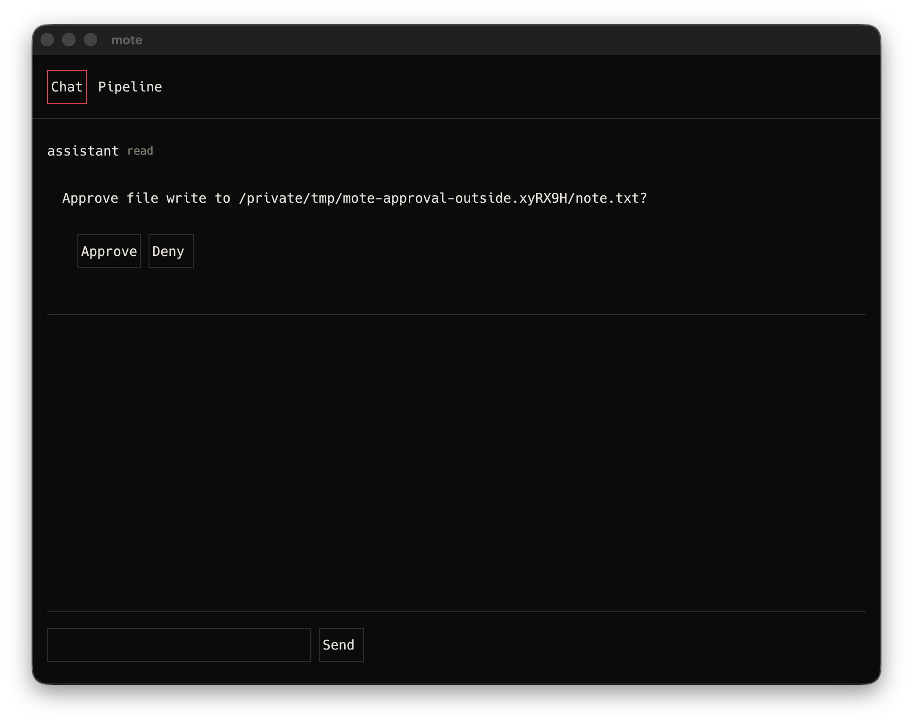

# V0-52 verification

Item: A `file_write` outside the data directory creates an approval card, nothing executes until
Approve, and Deny or expiry leaves it unexecuted.

Section: docs/rfcs/v0.md#15-watchers-and-approvals

## Status: VERIFIED

The daemon-to-client card path, containment and lifecycle are verified. The required native
approval-card screenshot is recorded below.

## Environment

- Date: 2026-10-10
- Host: owner's Mac, Darwin 25.6.0 (arm64)
- Toolchain: cargo 1.89.0
- Network: none

## Evidence

`request_file_write` canonicalizes the data directory. It canonicalizes an existing target. For a
nonexistent target it canonicalizes the immediate parent and appends the filename. Containment is
then decided on resolved paths. A nonexistent traversal target and a nonexistent child below an
in-data symlink to an outside directory both create pending approvals and write nothing. An
existing symlink whose destination cannot be resolved fails closed without writing.

The resolved parent is opened from the root one component at a time with descriptor-relative
`openat`. Directory components and the final target use `O_NOFOLLOW`. The validated parent handle
stays open through the target open and write. A second descriptor-relative walk confirms that the
named parent still has the same device and inode after validation. Deterministic hooks replace the
parent with an outside symlink after validation and before target open. Direct and approved writes
both fail without writing either the redirected target or the original renamed directory.

Existing final targets are opened without truncation and bound by device and inode. After the
synchronization point, the current name must open to the same identity. The held descriptor is
truncated and written only after that check. Expected-missing targets use `O_CREAT|O_EXCL`.
Deterministic tests replace an existing direct target with another regular file, replace an
approved target with a hardlink to another file, and create a missing target before target open.
Every case fails without changing the replacement or parked original.

Pending payloads retain the original requested path, canonical destination and expected target
identity. The approval card displays the canonical destination. Approval re-resolves the original
path and requires the destination and identity to match. A regression retargets a pending symlink
from file A to file B. Approval returns an internal error. Neither file changes. The row remains
pending and deniable. No accepted event is appended.

An inside write returns `Executed` only after the descriptor-bound write succeeds. An approved
outside write parses the stored payload into typed path and content fields, performs the filesystem
write, and only then changes the row to `approved`. Filesystem and payload failures are returned.
The approval stays pending, remains deniable and produces no accepted approval event.

The existing approval contract remains covered. Outside requests produce a validated inline card
on the requesting thread. Unknown, wrong-thread, non-pending and expired approvals do not execute.
Deny and expiry leave their targets unexecuted.

## Native approval-card acceptance

Release `moted` and `mote-client` ran with the isolated data root
`/private/tmp/mote-approval-home.OPmf1b`. A direct `file.write` request targeted
`/private/tmp/mote-approval-outside.xyRX9H/note.txt`, outside that data root. The daemon returned
`{"decision":"pending","id":1}` and emitted one inline `ui.surface` on thread `main`.

The native client displayed the resolved destination with separate Approve and Deny actions:



The PNG is 1936 by 1536 pixels. SHA-256:
`74ae03d6297f610fce8aeaafbdc0103121ca90afbedae6116ffd3e9de8513145`.

The approval row remained `pending`. The target file did not exist after capture. The existing
tests below cover Approve, Deny, expiry, cross-thread rejection and containment. This completes the
test-plus-screenshot Verify clause.

## Commands and output

```text
$ cargo test -p moted watchers::tests -- --nocapture
test result: ok. 14 passed; 0 failed

$ cargo test -p moted approval_dispatch_tests -- --nocapture
test result: ok. 33 passed; 0 failed

$ cargo test --workspace
test result: ok. All workspace and documentation tests passed.

$ cargo clippy --workspace -- -D warnings
Finished successfully with warnings denied.

$ git diff --check
No output. Exit 0.
```
